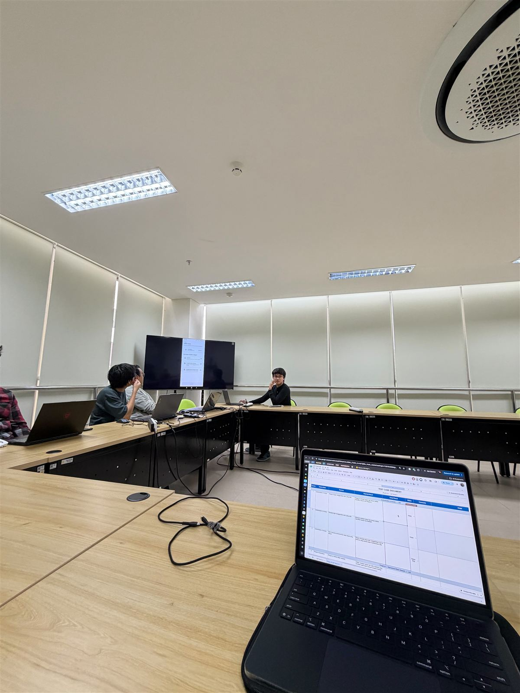
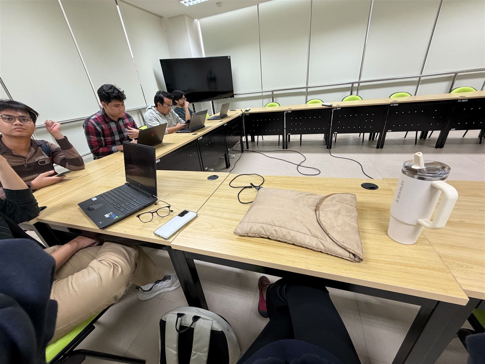
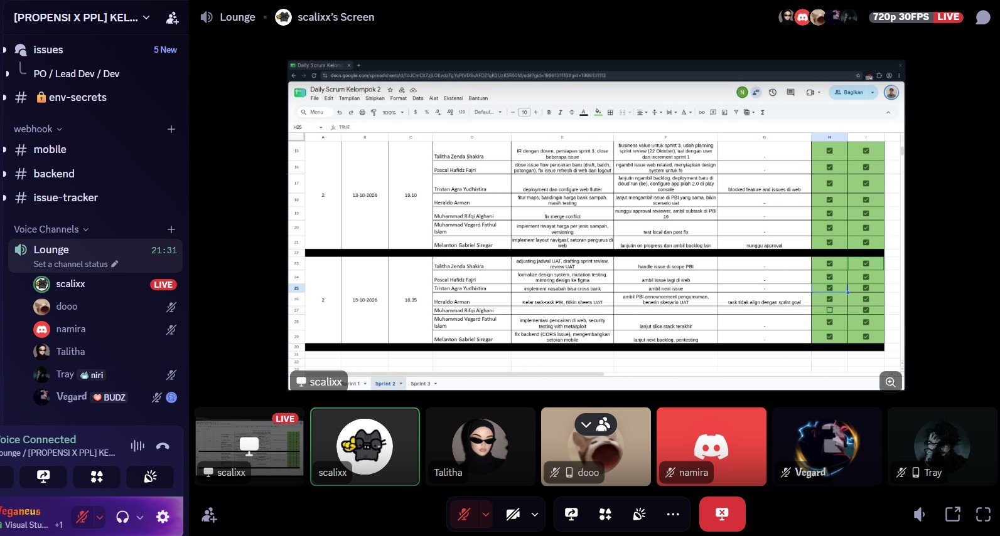

# Work Log

What was done, when, and how long it took.

**How durations are measured:** from the timestamps of the Claude Code session and the commits, grouped into blocks separated by gaps of more than 45 minutes. Times are WIB. Rows marked *self-reported* use my own figure, and rows marked *estimate* cover work with no session behind it (for example decisions settled on Discord). The log covers hands-on development work and, from the week of 22 Sep, the team's standups (on Discord every Monday, Wednesday and Friday, 15–30 minutes, counted at 15) and the offline team sessions (UAT); other meetings and offline reading are not included.

## Summary

| Week | Work time |
|---|---|
| 15–21 Sep | 3 h 45 min |
| 22–28 Sep | 20 h 10 min, of which 3 h is the offline UAT and standup and 30 min the Discord standups |
| 29 Sep – 5 Oct | 1 h 11 min |
| 6–12 Oct (Sprint 2 week 1) | 10 h 23 min, of which 2 h is Sprint Planning 2 |
| 13–19 Oct (Sprint 2 week 1, continued) | 13 h 8 min, of which 1 h 1 min is the three Discord standups, 30 min reading and ~1 h 30 min the security scan |
| 20–26 Oct (Sprint 2 week 2, in progress) | 9 h 29 min so far, of which 3 h is the Sprint 2 Review, UAT and Retrospective and 30 min the two Discord standups |
| **Total** | **58 h 6 min** |

Rows are grouped by the date the work happened. The IR pages group the same work differently: PIL-176 is claimed in [week 1](../review/index.md), and PIL-222 — started late on 22 Sep, reviewed and finished afterwards — in [week 2](../review-week-2/index.md), together with PIL-230 and the second review round on PIL-176.

## Week of 15–21 Sep

| Date | Time | Duration | Work | Output |
|---|---|---|---|---|
| Wed 16 Sep | — | not tracked | Drafted the PIL-176 task plan: scope, data model, API contract, test list, open questions | [Task plan](../sprints/sprint-1/tasks/PIL-176-pencatatan-pencairan-plan.md) |
| Thu 17 Sep | 14:18–14:38 | 20 min | Set up the workspace workflow notes; reviewed the sprint plan and listed questions for the team; checked Sprint 1 status in Linear; fixed `git fetch` (missing GitHub host key); moved both app repos to `staging` | — |
| Sun 20 Sep | 15:02–16:38 | 1 h 36 min | Recorded the PO's answers; **built the PIL-176 backend test-first** (model, atomic service, API, saldo-history fix); opened the PR; resolved the migration clash with #18 by stacking and renumbering; verified a from-scratch migrate; updated docs | [pilah-be #19](https://github.com/bank-sampah-PILAH/pilah-be/pull/19) |
| Mon 21 Sep | 19:43–21:32 | 1 h 49 min | **Addressed Heraldo's review**: 3 findings, each fixed test-first and answered in its thread; rebased onto the updated #18; prepared the daily scrum update; analysed test coverage | [Review threads](https://github.com/bank-sampah-PILAH/pilah-be/pull/19) |

## Week of 22–28 Sep

| Date | Time | Duration | Work | Output |
|---|---|---|---|---|
| Tue 22 Sep | 01:24–01:31 | 7 min | Removed an unreachable code branch; added the missing `pencairan` check to `reset_testing_data` (test first); pushed the docs update | [`bd38dc6`](https://github.com/bank-sampah-PILAH/pilah-be/commit/bd38dc6), [`b98a29b`](https://github.com/bank-sampah-PILAH/pilah-be/commit/b98a29b) |
| Tue 22 Sep | 13:05–15:51 | 2 h 46 min | Fixed a test that failed on Postgres only; retargeted #19 to `staging`; produced coverage reports (HTML, JSON, diff-cover); collected SonarQube evidence; built the coverage evidence page and the Individual Review pages; published the redacted AI prompt history | [Coverage evidence](../sprints/sprint-1/evidence/PIL-176-coverage.md), [Individual Review](../review/index.md) |
| Tue 22 Sep | from 19:16 | ≈ 3 h *(self-reported)* | **Built the PIL-176 mobile side test-first**: installed Flutter 3.38.3 to match CI; scaffolded with the SPL CLI; nominal validation, data layer, form cubit, form page, entry point (24 tests); opened the PR | [pilah-mobile #26](https://github.com/bank-sampah-PILAH/pilah-mobile/pull/26) |
| Tue 22 Sep | 20:25–20:58 | 33 min | Requested review from Heraldo on both PRs; renamed both PRs to the `PIL-XXX:` title format; updated the Individual Review pages | — |
| Tue 22 Sep | 21:00–23:11 | 2 h 11 min | **Built PIL-222 test-first on both sides**: periode and nasabah-name filters on the pencairan list, reusing the transaksi period logic; riwayat screen for the whole bank and per nasabah, with grouping and a detail sheet; opened both PRs stacked on PIL-176 | [pilah-be #32](https://github.com/bank-sampah-PILAH/pilah-be/pull/32), [pilah-mobile #27](https://github.com/bank-sampah-PILAH/pilah-mobile/pull/27) |
| Wed 23 Sep | — | 15 min *(self-reported)* | **Daily standup on Discord** (the team's Monday–Wednesday–Friday standup): progress, plans and blockers; counted at the low end of the usual 15–30 minutes | — |
| Wed 23 – Thu 24 Sep | 23:32–00:48, 12:58–15:17 | 2 h 44 min | **Answered Heraldo's review of all three open PRs**: verified each of the 8 findings against the code, fixed them test-first, replied in each thread; diagnosed why the mobile SonarQube project analyses no Dart; reorganised the IR pages into week 1 and week 2 | [Review threads](https://github.com/bank-sampah-PILAH/pilah-mobile/pull/27), [`a6cdfe6`](https://github.com/bank-sampah-PILAH/pilah-mobile/commit/a6cdfe6) |
| Thu 24 Sep | from 17:33 | 15 min *(estimate)* | Checked whether PIL-230 could start: Linear status (unassigned, no description) and readiness of the four PIL-176/222 PRs (CI, merge state, open threads, approvals); found the ticket's "edit" conflicted with the SDS's append-only rule and listed the options | — |
| Fri 25 Sep | 19:34, 22:35–23:09 | 35 min | Re-read PIL-230 after Tristan's description (edit + versioning); scoped it into a revision table, saldo recompute and endpoints; requested Tristan's review of #19 through the `ask-for-review` skill; wrote the 3P update | [pilah-be #19](https://github.com/bank-sampah-PILAH/pilah-be/pull/19) |
| Fri 25 Sep | — | 15 min *(self-reported)* | **Daily standup on Discord** (the team's Monday–Wednesday–Friday standup): progress, plans and blockers; counted at the low end of the usual 15–30 minutes | — |
| Sat 26 Sep | — | 30 min *(estimate)* | **Settled PIL-230's open questions** with the PO (Talitha) and lead (Tristan) on Discord: recompute later snapshots, reason required, 7-day backdating limit, nasabah see only the latest version; recorded the decisions and scope in the Linear issue; noted Tray's prod DB snapshot for migration testing | [PIL-230](https://linear.app/pilah-2/issue/PIL-230) |
| Sat 26 Sep | 19:53–20:58 | 1 h 5 min | **Answered Tristan's review of #19**: verified the 4 findings (nasabah read access, backdated payouts, rounding vs history, admin writes), fixed each test-first, replied in each thread; merged `staging` and added a merge migration for the two `0012` leaves; test-merged every open backend PR against #19 and warned the 9 that will conflict | [pilah-be #19](https://github.com/bank-sampah-PILAH/pilah-be/pull/19), [`290bb1d`](https://github.com/bank-sampah-PILAH/pilah-be/commit/290bb1d) |
| Sat 26 Sep | 20:58–21:35 | 37 min | **Built the PIL-230 backend test-first**: append-only revision table, `PATCH` edit with a ledger replay that recomputes every later snapshot, 7-day backdating limit, revision history endpoint, read-only admin, constant list queries (14 tests); opened the PR stacked on #32 | [pilah-be #52](https://github.com/bank-sampah-PILAH/pilah-be/pull/52) |
| Sat 26 Sep | 21:35–22:05 | 30 min | **Built the PIL-230 mobile side test-first**: edit form with required alasan and a date picker bounded by the backend's limit, change-history page, *Diperbarui* mark and entry points in the riwayat (16 tests); opened the PR stacked on #27 | [pilah-mobile #33](https://github.com/bank-sampah-PILAH/pilah-mobile/pull/33) |
| Sun 27 Sep | 18:43–19:07 | 24 min | Answered a teammate's question on integrating #19 into four nasabah PRs: test-merged each against `staging` and #19, advised keeping them separate (one merge migration at merge time); checked the permission-class agreement against the code and the lead's stacking proposal, and flagged its merge-order and rebase catches | — |
| Mon 28 Sep | 15:41–16:36, 20:22–20:50 | 1 h 23 min | Confirmed all six pencairan PRs were squash-merged to `staging` and live on the staging API; set up an Android emulator for testing the staging APK (diagnosed a crash to disk space and an off-screen window); wrote the 3P; built the week-2 AI Literacy page and its redacted prompt history | [AI Literacy](../review-week-2/part-b/ai-literacy.md) |
| Mon 28 Sep | — | 3 h *(self-reported)* | **Offline UAT and standup session** with the team: walked through the UAT test case document for Sprint 1, checked features on the shared screen, and gave the standup update | Photos below |

### Offline UAT and standup — 28 Sep

{ width="340" }

{ width="520" }

## Week of 29 Sep – 5 Oct

Sprint 1 closed this week (UAT on 29 Sep, Sprint Review 1 on 1 Oct). My Sprint 1 issues were already merged, so the logged work is documentation for the IR and one verification on a teammate's PR.

| Date | Time | Duration | Work | Output |
|---|---|---|---|---|
| Tue 29 Sep | 13:25–14:01 | 35 min | Saved the "name 5+ OWASP categories in commits" rule for future work; loaded the staging APK into the emulator; started the IR Part C pages and their navigation | — |
| Tue 29 Sep | 15:02–15:04 | 2 min | Rebased pilah-be #67 onto `staging`, which already had the CI fix | [pilah-be #67](https://github.com/bank-sampah-PILAH/pilah-be/pull/67) |
| Tue 29 Sep | 19:09–19:34 | 24 min | Updated the week-2 Part B pages (#67's SonarQube fix and pilah-mobile #52 merged); wrote the Part C pages: Grow Together, the Discord standups under Commitment, and Aptitude narrowed to three learnings | [Part C](../review-part-c/index.md) |
| Tue 29 Sep | 21:15–21:21 | 6 min | Mapped week 2's code to SOLID with code blocks, and set SOLID as a rule for future commits | [Programming, week 2](../review-week-2/part-b/programming.md) |
| Fri 2 Oct | 17:39–17:43 | 4 min | **Verified Pascal's scope claim on Heraldo's #64** against git history (#50 merged, then reverted) and commented with the links | [Comment](https://github.com/bank-sampah-PILAH/pilah-be/pull/64#issuecomment-5950650947) |

## Week of 6–12 Oct (Sprint 2 week 1)

Sprint 2 started with Sprint Planning 2 on 6 Oct. Details per day are in the [Sprint 2 progress log](../sprints/sprint-2/progress.md). The IR claims 7–9 Oct in [Sprint 1 Week 3](../review-week-3/index.md) and 10–12 Oct in [Sprint 2 Week 1](../review-sprint-2-week-1/index.md).

| Date | Time | Duration | Work | Output |
|---|---|---|---|---|
| Tue 6 Oct | — | 2 h *(self-reported)* | **Sprint Planning 2** with the team | — |
| Wed 7 Oct | 00:17–00:18 | 1 min | Checked Linear for Sprint 2 issues | — |
| Wed 7 Oct | 17:28–19:36 | 2 h 8 min | Took PIL-304 (the only issue no teammate blocked) and released PIL-341; agreed two design decisions; **built PIL-304 test-first on both sides** and opened both PRs; ran the backend on Postgres 16 and tested the migration on a copy of the production database; fixed the `pull_request` CI after #74 landed on `staging` | [pilah-be #79](https://github.com/bank-sampah-PILAH/pilah-be/pull/79), [pilah-mobile #62](https://github.com/bank-sampah-PILAH/pilah-mobile/pull/62) |
| Thu 8 Oct | 12:59–13:08 | 9 min | Wrote the 3P; **opened the rounding follow-up** promised in the PIL-176 review | [pilah-be #89](https://github.com/bank-sampah-PILAH/pilah-be/pull/89) |
| Thu 8 Oct | 22:05–22:17 | 12 min | Checked what week 3 could be claimed with, against the course calendar | — |
| Fri 9 Oct | 14:34–15:13 | 39 min | Installed the SonarQube CLI and checked all three PRs; fixed #62's SonarCloud issue test-first and brought its diff coverage to 100%; answered Gabriel's review of #89 with a test; **reviewed Pascal's #84** (PIL-300); added the jenis-filter allow-list (A03); wrote the week-3 Part B pages | [Review of #84](https://github.com/bank-sampah-PILAH/pilah-be/pull/84#pullrequestreview-5467271780), [IR week 3](../review-week-3/index.md) |
| Fri 9 Oct | 16:40–16:43 | 3 min | Added the session export to the AI Literacy evidence | [`1598cbc`](https://github.com/mvfi0/pilah-docs/commit/1598cbc) |
| Fri 9 Oct | 18:46–19:32 | 46 min | Finished the AI Literacy page (prompt-history screenshots), wrote the IR claim notes, and looked into #62's uncovered generated code | [AI Literacy, week 3](../review-week-3/part-b/ai-literacy.md) |
| Sun 11 Oct | 19:03–22:41 | 3 h 38 min | Tested PIL-304 locally on Flutter web; requested reviews of #79 and #62 (GitHub and Discord); **built PIL-331 test-first on both sides** and opened both PRs, stacked on PIL-304; traced the uncovered lines to the generated DI graph, found that CI-built apps would crash on launch, and **opened the fix** | [pilah-be #92](https://github.com/bank-sampah-PILAH/pilah-be/pull/92), [pilah-mobile #73](https://github.com/bank-sampah-PILAH/pilah-mobile/pull/73), [pilah-mobile #74](https://github.com/bank-sampah-PILAH/pilah-mobile/pull/74) |
| Mon 12 Oct | 17:41–18:28 | 47 min | **Answered Tristan's review**: verified all 8 notes; fixed the seed's write path and historical prices on #79; moved the filter allow-list into its own stacked PR; fixed #62's partial-save message and refresh race, and #73's lost sen and unread pages (all test-first); resolved #74's conflict; replied in each thread | [pilah-be #96](https://github.com/bank-sampah-PILAH/pilah-be/pull/96), [#79 threads](https://github.com/bank-sampah-PILAH/pilah-be/pull/79) |

## Week of 13–19 Oct (Sprint 2 week 1, continued)

| Date | Time | Duration | Work | Output |
|---|---|---|---|---|
| Tue 13 Oct | — | 25 min *(self-reported)* | **Daily standup on Discord** with the team: progress, plans and blockers (the call timer read 25:27 when the screenshot below was taken) | Screenshot below |
| Tue 13 Oct | 18:11–20:41 | 2 h 30 min | Checked the open PRs for new activity. Merged `staging` into #74 again; covered the lines #62 and #73 add to the generated DI graph; reran the full checks and pushed all three; replied in the #73 and #74 threads. Wrote the 3P; updated the IR week-3 pages and this log. Took **PIL-341** (pencairan on web) and built slice 1, browser downloads for exports, test-first. The Chrome test was shown red in CI before the implementation | [pilah-mobile #83](https://github.com/bank-sampah-PILAH/pilah-mobile/pull/83) |
| Tue 13 Oct | 21:40–23:45 | 2 h 5 min | **Reviewed and approved Gabriel's PIL-354** (CORS headers) with two inline suggestions; fixed #83's SonarCloud gate and marked it ready. Built PIL-341 slice 2 test-first: catat, ubah and revisi pencairan on a desktop window, and routes that survive a refresh. Ran it in a local build with Playwright and took desktop and phone screenshots, which caught a dialog bug | [Review of #97](https://github.com/bank-sampah-PILAH/pilah-be/pull/97#pullrequestreview-5505285204), [pilah-mobile #84](https://github.com/bank-sampah-PILAH/pilah-mobile/pull/84) |
| Tue 13 Oct | — | 30 min *(self-reported)* | Read about Playwright: what it is for, how it differs from Selenium (auto-waiting, browser contexts), and how it reaches Flutter web through the semantics tree | — |
| Wed 14 Oct | — | ~1 h 30 min *(self-reported)* | **Security scan of the backend with Metasploit.** Installed Metasploit in WSL, ran the HTTP auxiliary scanners against a local instance, verified with `curl` and cross-checked with `check --deploy`, and wrote the report with a test-first patch plan. Found the API schema/docs exposed without auth, plus HSTS/CSP gaps | [Security scan report](../security/index.md) |
| Thu 15 Oct | — | 21 min *(self-reported)* | **Daily standup on Discord** with the team (call timer 21:31 in the screenshot below); reported progress on the PIL-341 web slices and the Metasploit security testing | Screenshot below |
| Fri 16 Oct | 00:11–00:13, 18:04–19:38 | 1 h 36 min | **Reviewed Ghani's PIL-248** (operational report): ran the suite, measured the coverage change and benchmarked a database-aggregate version of the new summary before posting it. Added the reviews of #97 and #104 and the 13 Oct Playwright conversation to the Sprint 2 Week 1 IR pages. Started bringing the PIL-304 branches up to date with `staging` (the four mobile conflicts resolved, finished the next day) | [Review of #104](https://github.com/bank-sampah-PILAH/pilah-be/pull/104#pullrequestreview-5547040301) |
| Sat 17 Oct | 15:01–18:52, 22:11–22:13 | 3 h 53 min | **Merged my 8 approved Sprint 2 PRs:** merged `staging` into each branch, resolved the conflicts (incl. semantic ones that only showed in mypy and the design tests), reran the checks, waited for CI and merged each stack bottom first. Built **PIL-341 slice 3** test-first: the desktop side panel for the draft editor, dialogs from tablet width, centred columns, and a draft link that only accepts a bare id (A01, A03). Ran Playwright E2E at desktop and phone sizes and opened #127 | [pilah-mobile #127](https://github.com/bank-sampah-PILAH/pilah-mobile/pull/127) |
| Sun 18 Oct | 17:17–17:19 | 3 min | Checked #127 (merged by Pascal after his and Aldo's fixes), cleaned up its branch and worktree, and confirmed PIL-304, PIL-331 and PIL-341 were Done in Linear | — |
| Mon 19 Oct | — | 15 min *(self-reported)* | **Daily standup on Discord** with the team | — |

### Daily standup — 13 Oct

{ width="620" }

### Daily standup — 15 Oct

{ width="620" }

## Week of 20–26 Oct (Sprint 2 week 2)

The IR claims 16–23 Oct as [Sprint 2 Week 2](../review-sprint-2-week-2/index.md); 16–19 Oct is listed in the week above.

| Date | Time | Duration | Work | Output |
|---|---|---|---|---|
| Wed 21 Oct | — | 15 min *(self-reported)* | **Daily standup on Discord** with the team | — |
| Wed 21 Oct | 18:14–18:25, 19:11–22:47, 23:35–23:38 | 3 h 51 min | **Two QA findings on pencairan.** Traced the first ("Fail – High") to a deliberate ceiling pinned by tests, wrote a proposal for the team, and after the decision (warn, don't block, plus Pascal's confirmation) built **PIL-374** test-first: a note under the Nominal, a confirmation listing every affected nasabah, a line on each capped card. Fixed a SonarCloud complexity finding by refactoring. Found the second finding is a deliberate lock and built **PIL-375**: the locked Tanggal now looks locked. Playwright E2E on both, reviews requested, both merged after Aldo's approval | [pilah-mobile #153](https://github.com/bank-sampah-PILAH/pilah-mobile/pull/153), [#154](https://github.com/bank-sampah-PILAH/pilah-mobile/pull/154) |
| Thu 22 Oct | — | 3 h *(self-reported)* | **Sprint 2 Review, UAT and Retrospective** with the team | — |
| Fri 23 Oct | — | 15 min *(self-reported)* | **Daily standup on Discord** with the team | — |
| Fri 23 Oct | 15:33–17:08, 18:50–19:16, 20:36–20:38, 22:10–22:14 | 2 h 8 min | **Reviewed Ghani's pilah-mobile #162** (removing draft export): ran the tests locally, restored the old code to prove the new tests catch it (8 of 8 failed), and posted one question and two suggestions. Wrote the **Sprint 2 Week 2 IR pages** (all seven Part B competencies and Part C), with SonarCloud screenshots, the session export, presentation scripts for S2W1 and S2W2, and the claim notes | [Review of #162](https://github.com/bank-sampah-PILAH/pilah-mobile/pull/162#pullrequestreview-5626578469), [IR Sprint 2 Week 2](../review-sprint-2-week-2/index.md) |
