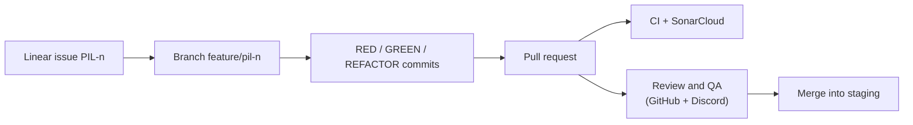

# Team Work with Tools

!!! success "Competency level: 2"
    - I follow the team's agreed workflow and its tools. All 33 of my PRs (16 backend, 17 app) went through it and were merged, and 26 of them name their Linear issue.
    - This page shows how using these tools in a disciplined way helps the team, and the problems we found in how the team uses them.

## What the rubric asks

| Level | Criterion |
|---|---|
| 1 | Understands the team's agreed workflow and uses the designated tools accordingly |
| **2** | Can show how disciplined use of these tools benefits group work, and explain the issues involved in evaluating the tools' use within the team |

## The team's tools

| Tool | What we use it for |
|---|---|
| **Linear** | The sprint backlog. Each requirement is an issue (`PIL-<n>`), and its status moves by itself when a PR is opened or a reviewer is assigned |
| **GitHub** | Code, pull requests, reviews and merges, in `pilah-be` and `pilah-mobile` |
| **GitHub Actions** | CI on every PR: format, analyze, tests with coverage. Deployment workflows too |
| **SonarCloud** | Code issues and coverage of new code, shown on every PR |
| **Discord** | Standups, and review and QA requests |
| **Shared agent workflows** (`ship`, `ask-for-review`, `ask-for-qa`, `tdd`) | The team's workflow written down once, so everyone's changes follow the same steps |
| **Composio** (my own setup) | Connects my coding agent to Linear, so I can read and update an issue from the editor |

## Following the agreed workflow

The workflow is in the workspace's [`WORKFLOW.md`](https://github.com/bank-sampah-PILAH/pilah/blob/main/WORKFLOW.md):

1. Branch and worktree.
2. Test-first commits.
3. A PR.
4. Review and QA.
5. Merge after approval.

| Step | My record (20 Sep – 23 Nov) |
|---|---|
| Branch named after the Linear issue | 25 of 33 branches use `feature/pil-<n>`, and one more PR names its issue in the title. The other 7 are small follow-up fixes with no issue of their own |
| Commits | Conventional Commits with the TDD phase, e.g. `test(harga): [RED] …`, `feat(harga): [GREEN] …` |
| Pull request | All 33 have a Testing section with the commands run and the coverage |
| Review | Each finding answered in its own thread, with the fix commit linked |
| Merge | 33 of 33 merged, after approval. Median time from opening to merge: 3.9 days |

## How disciplined tool use helps the team

- **Issue ↔ branch ↔ PR.** Anyone can go from a Linear issue to its code, or from a PR back to the requirement, and Linear's status stays current without asking.
- **The same branch name in both repos.** A feature that spans backend and app, such as `feature/pil-451`, is found and reviewed as one unit.
- **Phase-tagged commits.** A reviewer can check the TDD order from the commit list alone.
- **A Testing section in every PR.** The reviewer sees what was run before starting the review.
- **SonarCloud before review.** Code smells and coverage gaps are fixed before a teammate spends time on them.
- **Replies in the finding's thread.** The reviewer sees each point closed where they raised it.

## Problems in how the team uses its tools

| Problem | Effect on the team |
|---|---|
| The generated dependency-injection file was excluded from coverage and from SonarCloud | A missing dependency only showed up when the app crashed on launch. I fixed this in [pilah-mobile #74](https://github.com/bank-sampah-PILAH/pilah-mobile/pull/74), and teammates now add to its check |
| Coverage runs on the Dart VM, which can't compile browser-only code | A correct web change fails the coverage gate unless the file is tested in Chrome instead |
| Two PRs can add a migration with the same number, and Git shows no conflict | `migrate` fails on `staging` after the second merge, so it has to be flagged by hand on both PRs |
| CI runs only the tests of changed files, but SonarCloud counts nearby old lines as new | A PR's coverage on SonarCloud can drop for lines it didn't write |
| SonarCloud sometimes refused the CI runner with 403 errors | PR checks failed for reasons unrelated to the code (fixed by Heraldo on 6 Oct) |

## Mapping to the rubric

| Level | Criterion | Evidence |
|---|---|---|
| 1 | Understands the agreed workflow and uses the designated tools | [The team's tools](#the-teams-tools), [Following the agreed workflow](#following-the-agreed-workflow) |
| 2 | Shows how disciplined tool use benefits group work | [How disciplined tool use helps the team](#how-disciplined-tool-use-helps-the-team) |
| 2 | Explains the issues in evaluating the tools' use within the team | [Problems in how the team uses its tools](#problems-in-how-the-team-uses-its-tools) |
