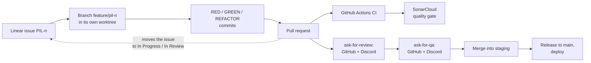

# Team Work with Tools

!!! success "Competency level: 3"
    - **Following the team's workflow:** all 33 of my PRs went through it (16 backend, 17 app), and every one was merged. 26 of them name their Linear issue.
    - **Reviews given:** 11 PRs from four teammates.
    - **Solutions to tool problems the team hit, mostly across tool boundaries:** Linear ↔ GitHub, GitHub Actions ↔ SonarCloud, QA and UAT ↔ Linear ↔ PRs, security scans ↔ Linear. The clearest is the coverage check on the generated dependency graph ([pilah-mobile #74](https://github.com/bank-sampah-PILAH/pilah-mobile/pull/74)). It still runs in CI on `staging`, and three teammates have since added their own registrations to it.

Contents:

1. [What the rubric asks](#1-what-the-rubric-asks)
2. [The team's tools and how they connect](#2-the-teams-tools-and-how-they-connect)
3. [Following the agreed workflow](#3-following-the-agreed-workflow)
4. [How disciplined tool use helps the group](#4-how-disciplined-tool-use-helps-the-group)
5. [Problems found in how the team uses its tools](#5-problems-found-in-how-the-team-uses-its-tools)
6. [Solutions I provided](#6-solutions-i-provided)
7. [One requirement, end to end](#7-one-requirement-end-to-end)
8. [Reviews given to the team](#8-reviews-given-to-the-team)
9. [Mapping to the rubric](#9-mapping-to-the-rubric)

## 1. What the rubric asks

| Level | Criterion |
|---|---|
| 1 | Understands the team's agreed workflow and uses the designated tools accordingly |
| 2 | Can show how disciplined use of these tools benefits group work, and explain the issues involved in evaluating the tools' use within the team |
| **3** | Provides solutions to issues that occur, so they benefit the team, e.g. making the most of tool features from requirements through to deployment, including integration between tools |
| 4 | Demonstrates an increase in team productivity from the solution in level 3, against a specific teamwork quality standard |

## 2. The team's tools and how they connect

| Tool | What the team uses it for | Connected to |
|---|---|---|
| **Linear** | Sprint backlog: one issue per requirement (`PIL-<n>`), with acceptance criteria, QA findings and decisions written into the issue | GitHub: a branch named `feature/pil-<n>` links the PR to the issue, and Linear moves the issue to *In Progress* when the PR opens and *In Review* when a reviewer is assigned |
| **GitHub** | Code, pull requests, reviews, merges. Two app repos (`pilah-be`, `pilah-mobile`) plus a workspace repo for shared agent workflows | Linear (above), GitHub Actions, SonarCloud, Discord |
| **Git worktrees** | One isolated working copy per branch, so the main checkout stays clean on `staging` | — |
| **GitHub Actions** | CI on every push and pull request: format, analyze, tests with coverage. Deployment workflows: the backend deploys to Cloud Run on a push to `main`; app releases run through the CD workflows | SonarCloud (coverage report), Fly / Cloud Run / Play |
| **SonarCloud** | Code issues and coverage of new code on every PR, with a quality gate | GitHub: results posted on the PR |
| **Discord** | Standups, review and QA requests | GitHub: the team's `ask-for-review` and `ask-for-qa` workflows assign the person on GitHub and post to the review or QA channel |
| **Shared agent workflows** (`.agents/skills`) | `ship`, `multi-ship`, `multi-lgtm`, `ask-for-review`, `ask-for-qa`, `tdd`: the team's workflow written down once, so every member's changes follow the same steps | All of the above |
| **Composio** (my own setup, not a team tool) | Connects my coding agent (Claude Code) to Linear, so I read an issue's acceptance criteria and update the issue from the same editor I write the code in. I approve every Linear edit it makes | Linear. GitHub goes through `gh` instead |

The path one requirement takes through these tools:



## 3. Following the agreed workflow

The workflow is written in the workspace's [`WORKFLOW.md`](https://github.com/bank-sampah-PILAH/pilah/blob/main/WORKFLOW.md), set up by Tristan, our lead dev:

1. Branch.
2. Worktree.
3. Implement test-first.
4. Validate.
5. Conventional Commits.
6. Push and open a self-assigned PR.
7. Review and QA.
8. Merge after approval.
9. Delete the branch and the worktree.

How my work followed it, 20 Sep – 23 Nov:

| Step | What the team agreed | My record |
|---|---|---|
| Issue and branch | `feature/pil-<n>` when there is a Linear issue (adopted 20 Sep); `fix/<name>` or `feature/<name>` when there isn't | **25 of 33** branches carry `pil-<n>`, and one more PR names its issue in the title. The other 7 are follow-up fixes and refactors with no issue of their own, such as [#67](https://github.com/bank-sampah-PILAH/pilah-be/pull/67) (a SonarCloud finding) and [#74](https://github.com/bank-sampah-PILAH/pilah-mobile/pull/74). PIL-176 keeps the older long branch name because it was opened before the change |
| Worktree | Feature work in an isolated worktree, never in the main checkout | Feature branches are worked in `pilah-be-worktrees/` and `pilah-mobile-worktrees/`, while the main checkouts stay on `staging` |
| Commits | Conventional Commits; TDD phase in the subject | `test(harga): [RED] …`, `feat(harga): [GREEN] …`, `refactor(ledger): [REFACTOR] …`. See [TDD, section 3](tdd.md#3-tdd-commit-flow-with-evidence-of-the-order) |
| Pull request | Self-assigned, with a description reviewers can check | **All 33** PR descriptions have a Testing section with the commands run and the coverage. [#74's description](https://github.com/bank-sampah-PILAH/pilah-mobile/pull/74) is an example |
| Review and QA | Request through `ask-for-review` / `ask-for-qa`; answer each finding in its thread | Findings answered in their own threads, with the fix commit linked (Part B Team Development Management pages, e.g. [S3W1](../review-sprint-3-week-1/part-b/team-development-management.md)) |
| Merge | Only after checks and approvals pass | **33 of 33 merged.** Median time from opening to merge: **3.9 days**. The longest, PIL-451 (23 days), went through two review rounds and then waited on a change request I didn't bypass ([S3W3](../review-part-c/sprint-3-week-3/grow-together.md)) |

## 4. How disciplined tool use helps the group

| Practice | Why it helps the team | Example |
|---|---|---|
| **One issue ↔ one branch ↔ one PR** | Anyone can find the code for a requirement from Linear, or the requirement behind a PR from GitHub. The status in Linear updates itself, so standups don't need to ask "is it in review yet?" | PIL-428 → `feature/pil-428` → [pilah-be #145](https://github.com/bank-sampah-PILAH/pilah-be/pull/145) and [pilah-mobile #193](https://github.com/bank-sampah-PILAH/pilah-mobile/pull/193) |
| **Same branch name in both repos** | A feature that spans backend and app is found and reviewed as one unit | `feature/pil-451` in both repos: be #137 and mobile #174 |
| **Phase-tagged commits** | A reviewer can check the TDD order from `git log` alone, and see each review fix as its own small red/green pair | [TDD page, section 7.1](tdd.md#71-defects-caught-by-a-failing-test-before-merge): six review findings fixed in green commits of +4 to +17 lines |
| **A Testing section in every PR** | The reviewer sees what was run and on which database, without re-running everything to start the review | [#74](https://github.com/bank-sampah-PILAH/pilah-mobile/pull/74): the exact commands, the coverage of the generated file, and which local failures are Windows-only |
| **SonarCloud before review** | Code smells and coverage gaps are fixed before a person spends time on them | #193's refactor after SonarCloud S3358 ([`ca2ec7a`](https://github.com/bank-sampah-PILAH/pilah-mobile/commit/ca2ec7a2)) |
| **Replies in the finding's thread** | The reviewer sees each point closed where they raised it, with the commit, and can resolve it in one click | Part B Team Development Management pages |
| **Stacked PRs** | The next feature can start before the previous one is merged, without mixing two features into one review | PIL-176 → PIL-222 → PIL-230: three PRs per repo, each reviewed on its own, all six merged on 28 Sep |

## 5. Problems found in how the team uses its tools

Using the tools in a disciplined way also showed where they didn't fit how we worked. Each problem below was real; section 6 says which ones I solved.

| # | Problem | Why it mattered | Found by |
|---|---|---|---|
| P1 | The code generator marks `di.config.dart` "coverage: ignore", and SonarCloud also excluded it | A dependency the graph couldn't provide was invisible until the app crashed on launch. A CI-built app couldn't build `AuthenticationBloc` (fixed by Tristan in #71) | Me, getting #62 and #73 to 100% on SonarCloud |
| P2 | `flutter test --coverage` runs on the Dart VM, which can't compile browser-only code | Every line of a web-only file counts as uncovered, so a correct PR fails the coverage gate | Me, on PIL-341 |
| P3 | Two PRs can add a migration with the same number, and Git shows no conflict | `migrate` fails on `staging` after the second merge | Me, checking open PRs against mine |
| P4 | CI runs only the tests of changed files, but SonarCloud counts nearby pre-existing lines as new | A PR's coverage on SonarCloud dropped to 97.1% for lines it didn't write | Me, on [#174](https://github.com/bank-sampah-PILAH/pilah-mobile/pull/174) |
| P5 | A QA finding or a UAT remark is only a remark until it becomes an issue with a decision | Without that, it can be argued over or forgotten instead of becoming planned work | The Sprint 2 QA round and the 6 Nov UAT |
| P6 | A security scan finds problems in other people's code | Fixing them inside an unrelated PR hides them from their owners and from review | Me, on the 9 Nov scan |
| P7 | A Django debug page in a scan dumped the machine's environment into published evidence, including the team's Discord review and QA webhooks | Anyone could post as the team's bot. Discord revoked both webhooks, so the review and QA notifications needed new ones | Discord's scanner, 13 Nov. The leak was mine |
| P8 | SonarCloud refused the CI runner with 403s | PR checks failed for reasons unrelated to the code | Heraldo, who fixed it in CI on 6 Oct |

## 6. Solutions I provided

### S1. The generated dependency graph, tested and measured in CI (P1)

**Tools involved:** GitHub Actions, SonarCloud, the test suite, `AGENTS.md`. Delivered in [pilah-mobile #74](https://github.com/bank-sampah-PILAH/pilah-mobile/pull/74), merged 17 Oct.

- **A test that builds every registration.** [`06ece1b`](https://github.com/bank-sampah-PILAH/pilah-mobile/commit/06ece1ba) adds `di_graph_test`, which resolves all 92 registrations in dev and in prod. A dependency the graph can't provide now fails in CI, not at launch. A second test counts the registrations in the generated file, so a new one can't be left off the list.
- **CI measures the file instead of excluding it.**
    - [`941f24d`](https://github.com/bank-sampah-PILAH/pilah-mobile/commit/941f24d2) drops the generator's marker in both coverage jobs.
    - [`26fcf40`](https://github.com/bank-sampah-PILAH/pilah-mobile/commit/26fcf40e) removes the file from `sonar.exclusions`, as Tristan asked in review.
    - Result: all 223 executable lines covered.
- **The rule written down for the team.** `AGENTS.md` now says to commit the file as generated and to list each new registration.

```yaml title=".github/workflows/ci.yml (941f24d)"
      # injectable_generator writes `// coverage:ignore-file` into
      # di.config.dart, which drops the DI graph from lcov while SonarCloud
      # still counts its lines as uncovered. test/services/di_graph_test.dart
      # resolves every registration, so measure it like any other file.
      - name: Measure coverage of the generated DI graph
        run: sed -i '/^\/\/ coverage:ignore-file$/d' lib/services/di.config.dart
```

**Benefit to the team, from the history:**

- The step still runs in both coverage jobs of `ci.yml` on `staging`.
- Three teammates have since added their own registrations to the list, so the check grew with the app instead of going stale:
    - **Heraldo**, for pengumuman, 18 Oct ([`372c148`](https://github.com/bank-sampah-PILAH/pilah-mobile/commit/372c148d));
    - **Pascal**, for PIL-427 and PIL-454;
    - **Tristan**, in the Riverpod migration ([#160](https://github.com/bank-sampah-PILAH/pilah-mobile/pull/160)).

### S2. Browser-only code tested in Chrome, in CI (P2)

**Tools involved:** GitHub Actions, SonarCloud. Delivered in PIL-341 ([#83](https://github.com/bank-sampah-PILAH/pilah-mobile/pull/83)).

- The export downloader uses `package:web`, so it is tested in a real browser: [`0fce21c`](https://github.com/bank-sampah-PILAH/pilah-mobile/commit/0fce21c) adds its test to the CI job that runs Chrome tests.
- [`48cac00`](https://github.com/bank-sampah-PILAH/pilah-mobile/commit/48cac00c) leaves only that file out of the VM coverage metric, with the reason in the commit. This follows the precedent the team had set for the web-only Google sign-in button.
- A correct web PR no longer fails the gate, and the code is still tested where it actually runs.

### S3. A migration clash Git can't see, flagged on both PRs (P3)

**Tools involved:** GitHub PR comments.

My #137 and #145 both added migration `0029`. I commented on [#137](https://github.com/bank-sampah-PILAH/pilah-be/pull/137#issuecomment-6542913917) and [#145](https://github.com/bank-sampah-PILAH/pilah-be/pull/145#issuecomment-6542914469). Each comment links both files and says who renumbers, so whoever merges second knows what to do. Earlier, PIL-331's `0020`/`0021` collided with Pascal's draft-pencairan stack the same way, and that was raised for coordination before either merged.

### S4. Coverage in the files CI actually runs (P4)

**Tools involved:** GitHub Actions, SonarCloud.

On [#174](https://github.com/bank-sampah-PILAH/pilah-mobile/pull/174), [`b2344b5`](https://github.com/bank-sampah-PILAH/pilah-mobile/commit/b2344b5) covered the two pre-existing lines in the test files CI selects for the PR, which brought SonarCloud back to 100%. The cause is written up on the [S2W3 Code Quality page](../review-sprint-2-week-3/part-b/code-quality.md), so the next person who sees an unexplained drop knows where to look.

### S5. QA and UAT findings turned into Linear issues, then PRs (P5)

**Tools involved:** Linear, GitHub, Discord.

- **QA, Sprint 2.** QA marked draft pencairan "Fail – High".
    - I traced it to a deliberate ceiling rule and wrote the team a proposal: the cause, the tests that pin the rule, three options, and the decisions to make.
    - The decision is recorded in [PIL-374](https://linear.app/pilah-2/issue/PIL-374): warn, and confirm.
    - It shipped in [#153](https://github.com/bank-sampah-PILAH/pilah-mobile/pull/153), opened and merged on 21 Oct.
    - The second finding was a deliberate lock, so [PIL-375](https://linear.app/pilah-2/issue/PIL-375) tells QA how to retest it, and [#154](https://github.com/bank-sampah-PILAH/pilah-mobile/pull/154) makes the lock visible.
- **UAT, 6 Nov.** The team ran the session with the Pengurus from the task script and findings form I prepared for PIL-418. Two findings became [PIL-481 and PIL-480](#7-one-requirement-end-to-end), which shipped five days after the session.
- **Keeping Linear current while coding.** My coding agent reaches Linear through Composio, so I can read an issue and write a decision or a retest note back to it without leaving the code. Teammates who only look at Linear see the same state as the PR.

### S6. Security findings handed to their owners through Linear (P6)

**Tools involved:** OWASP ZAP, a reusable scan script, Linear, GitHub.

- [`tools/zap_scan.py`](https://github.com/mvfi0/pilah-docs/blob/main/tools/zap_scan.py) scans one finished sub-issue at a time.
- The 9 Nov scan found a new 500 in list views that other people own: a malformed `nasabah_id` filter. It went to Linear as PIL-482 instead of into an unrelated PR.
- The fix, [pilah-be #175](https://github.com/bank-sampah-PILAH/pilah-be/pull/175), was opened on 16 Nov and merged on 18 Nov.

### S7. A secret check in the scan tool, after my own leak (P7)

**Tools involved:** the scan script, Git.

[`2197468`](https://github.com/mvfi0/pilah-docs/commit/2197468):

- redacts the two webhooks from the evidence;
- makes `zap_scan.py` refuse to finish when its output holds a Discord or Slack webhook, a GitHub, Google or Slack token, or a database URL with a password;
- records what happened in the [report](../security/zap-2026-11-09.md#what-went-wrong-on-the-way).

The S3W3 Grow Together page records that the review and QA notifications need new webhooks.

## 7. One requirement, end to end

The path one UAT finding took through Linear, GitHub, CI, SonarCloud and a security scan, to `staging`, in five days:

| Date | Step | Tool | Evidence |
|---|---|---|---|
| 6 Nov | UAT with the Pengurus, run from the task script and findings form I prepared | Meeting, findings form | PIL-418 task script and findings form |
| After the UAT | Two findings tracked as issues: PIL-481 (hide a voided setoran from the riwayat lists) and PIL-480 (drop the ID Aktivitas column from the export) | Linear | PIL-481, PIL-480 |
| 9 Nov | Branches `feature/pil-481` and `feature/pil-480`, built test-first; three PRs opened | Git, GitHub | [pilah-be #167](https://github.com/bank-sampah-PILAH/pilah-be/pull/167), [pilah-be #168](https://github.com/bank-sampah-PILAH/pilah-be/pull/168), [pilah-mobile #238](https://github.com/bank-sampah-PILAH/pilah-mobile/pull/238) |
| 9 Nov | CI and the SonarCloud quality gate on each PR | GitHub Actions, SonarCloud | PR checks |
| 9 Nov | Security scan of both sub-issues | OWASP ZAP | [ZAP report, 9 Nov](../security/zap-2026-11-09.md) |
| 9–11 Nov | Review requested and answered in its threads | GitHub, Discord | PR threads |
| 11 Nov | All three merged into `staging` | GitHub | PR history |

## 8. Reviews given to the team

Eleven PRs reviewed across four teammates. Each review is on the matching week's Part B Team Development Management page.

| Repo | PR | Author | Topic |
|---|---|---|---|
| pilah-be | [#64](https://github.com/bank-sampah-PILAH/pilah-be/pull/64) | Heraldo | Modular monolith refactor and production migration |
| pilah-be | [#84](https://github.com/bank-sampah-PILAH/pilah-be/pull/84) | Pascal | PIL-300: confirm a draft pencairan atomically |
| pilah-be | [#97](https://github.com/bank-sampah-PILAH/pilah-be/pull/97) | Gabriel | PIL-354: CORS headers |
| pilah-be | [#104](https://github.com/bank-sampah-PILAH/pilah-be/pull/104) | Rifqi | PIL-248: operational summary and Excel export |
| pilah-be | [#144](https://github.com/bank-sampah-PILAH/pilah-be/pull/144) | Rifqi | PIL-442: stable nasabah ordering |
| pilah-be | [#169](https://github.com/bank-sampah-PILAH/pilah-be/pull/169) | Gabriel | PIL-478: nasabah without a birth date |
| pilah-be | [#174](https://github.com/bank-sampah-PILAH/pilah-be/pull/174) | Gabriel | Pinning the Swagger UI CDN files |
| pilah-mobile | [#162](https://github.com/bank-sampah-PILAH/pilah-mobile/pull/162) | Rifqi | Removing the draft export |
| pilah-mobile | [#178](https://github.com/bank-sampah-PILAH/pilah-mobile/pull/178) | Pascal | HSTS and Content-Security-Policy |
| pilah-mobile | [#202](https://github.com/bank-sampah-PILAH/pilah-mobile/pull/202) | Gabriel | PIL-436: hiding the Pengumuman entry points |
| pilah-mobile | [#243](https://github.com/bank-sampah-PILAH/pilah-mobile/pull/243) | Gabriel | PIL-478: optional birth date |

## 9. Mapping to the rubric

| Level | Criterion | Evidence | Status |
|---|---|---|---|
| 1 | Understands the agreed workflow and uses the designated tools | [Sections 2–3](#2-the-teams-tools-and-how-they-connect): 33 PRs through the workflow, all merged | Met |
| 2 | Shows how disciplined tool use benefits group work | [Section 4](#4-how-disciplined-tool-use-helps-the-group) | Met |
| 2 | Explains the issues in evaluating the tools' use within the team | [Section 5](#5-problems-found-in-how-the-team-uses-its-tools): eight problems, with their cost to the team | Met |
| 3 | Provides solutions to issues that benefit the team, from requirements through to deployment, including integration between tools | [Section 6](#6-solutions-i-provided), and [section 7](#7-one-requirement-end-to-end) for one requirement end to end | Met |
| 4 | Shows an increase in team productivity from those solutions, against a specific teamwork quality standard | I don't have a before/after measure of team productivity against a named standard | Not claimed |
