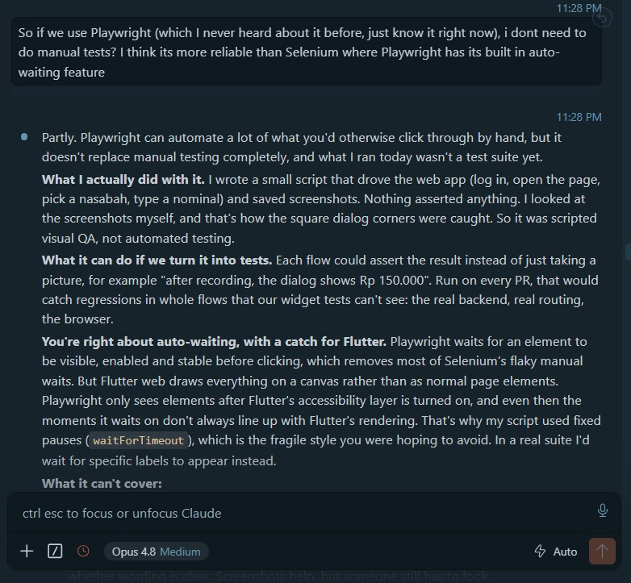
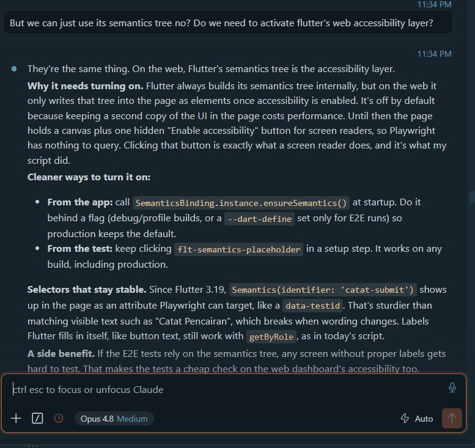
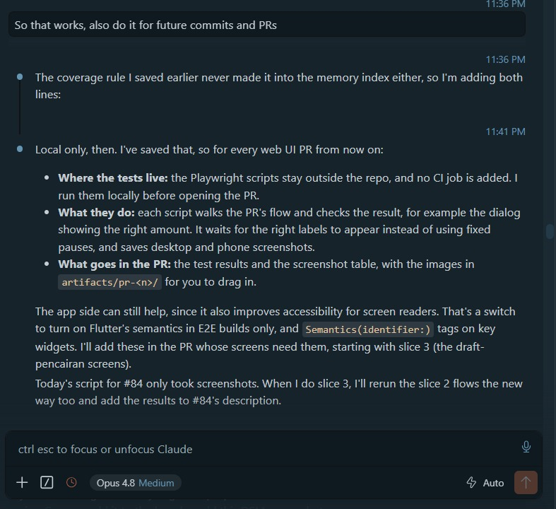

# AI Literacy

!!! success "Competency level: 3"
    AI used critically:

    - Its plans were checked against the code before being acted on.
    - Twice it caught and said that its own premise or check was wrong.
    - When I asked whether Playwright meant no more manual testing, it said where its own script fell short instead of agreeing.
    - Candidate review findings were measured before they were posted, and two were dropped.

    The decisions that affect the team (shared CI, a teammate's code, how to restructure PRs, whether E2E runs in CI) were put to me before anything changed.

Evidence for this week:

- [AI prompt history, 11–12 Oct](ai-prompt-history.html): 10 prompts with every tool call the agent made between them, built from the session transcript. Emails, home-folder paths and tokens are removed. The earlier part of the same session (7–9 Oct) is published with [Sprint 1 Week 3](../../review-week-3/part-b/ai-literacy.md).
- [Session export](ai-session-export.txt): Claude Code's own `/export` of the same session, from 11 to 16 Oct, with tool output collapsed as the export shows it. It includes the Playwright conversation, the review round and the Metasploit scan. Local home-folder paths are shortened to `~`; nothing else is changed.
- Screenshots of the 13 Oct conversation about Playwright, [below](#example-playwright-is-not-a-replacement-for-manual-testing).

## How AI was used this week

- **Tool:** Claude Code as an agent in VS Code across `pilah-be`, `pilah-mobile` and `pilah-docs`, Linear through Composio, GitHub through `gh`, and the SonarQube CLI and the SonarCloud API for coverage.
- **Guardrails:**
    - the workspace skills (`ship`, `tdd`, `ask-for-review`);
    - CI's own commands, run locally before every push;
    - rules kept in memory: phase-tagged commits, replying inside review threads, never merging base branches into stacked ones without asking.
    - **New this week:** cover 100% of the code, generated code included; back every web UI PR with Playwright E2E checks run through Flutter's semantics tree (13 Oct).
- **My role:**
    - picking PIL-331;
    - deciding its open points (a fixed "kg" until PIL-305, scheduled prices shown and marked, the entry point on the harga card);
    - setting the coverage rule;
    - choosing how to land the CI fix and how to stack the PRs;
    - keeping the Playwright checks local rather than adding a CI job.

## Where verification changed the outcome

| Situation | What happened |
|---|---|
| *11 Oct:* It offered "a button in the expanded card" as the entry point for the price history, and I picked it | On reading the page, it found the card wasn't expandable: tapping it opens the edit sheet. It **told me its option had been based on a wrong premise**, then put the button in the card's info column, the closest match to my choice. |
| *11 Oct:* SonarCloud showed #62/#73 a few lines short of 100%, all in generated code | I said to always cover 100%, generated or not. Rather than add an exclusion, it traced why lcov skipped the file, and found that the graph CI builds would crash the app on launch. |
| *11 Oct:* Its first check of that crash passed | It noticed `build_runner` had skipped regenerating the file and left the hand-edited copy in place, so **the check proved nothing**. It deleted the file, regenerated it, and only then reported the crash, with the exact error. |
| *11 Oct:* The crash fix touched the team's CI and a teammate's code | It stopped and asked how to land it (separate PR, inside #62, or just report it) before changing shared workflows. |
| *12 Oct:* Tristan's 8 review notes | Each was checked against the code before anything changed. All 8 held up. One (the Sonar exclusion) showed that `staging` had moved since the branch was cut. |
| *12 Oct:* "Can we use stacked PRs for #79 and #92?" | #92 was already stacked, so the question was ambiguous. It also checked its saved rule against merging a base branch into a stacked one. It **asked which stack shape I meant**, then used a revert plus `cherry-pick -x`, not a force-push, so last week's evidence links stay valid. |
| *12 Oct:* #74's crash fix became redundant when Tristan's #71 landed the same change | It took `staging`'s version in the conflict and rewrote the PR around what was still new, instead of keeping a duplicate fix. |
| *13 Oct:* I asked whether Playwright meant I wouldn't need manual tests | It answered "partly". It said its own run had only taken screenshots and asserted nothing, so it was visual QA and not a test suite, and that its fixed pauses were the fragile style I hoped to avoid. Then it listed what automation can't cover. [Screenshots below](#example-playwright-is-not-a-replacement-for-manual-testing). |
| *13 Oct:* "Do it for future commits and PRs" | It saved the rule, then asked where the checks should run instead of deciding itself. Its recommendation was a CI job with the API stubbed, which would touch the team's pipeline. I chose local only, and it rewrote the rule to match. It also noticed that an earlier rule (100% coverage) had been saved without an index entry, so future sessions would not have loaded it, and fixed that. |
| *16 Oct:* Reviewing Ghani's #104 | Three candidate findings were checked before posting. The CI coverage change was measured with and without `tests/` (99% either way), so it was dropped. The alternative to the spreadsheet escaping was tried and turned out worse, so it was dropped too. The performance suggestion went in only after a benchmark showed the same result from fewer queries. |

## Example: covering generated code turned up a crash

The obvious response to "97.4% on SonarCloud, the gap is generated code" is an exclusion line in `sonar.yml`. Instead:

1. **The cause.** It checked why the file was missing from lcov: the generator writes `// coverage:ignore-file`.
2. **The proposal.** It proposed resolving every registration in a test.
3. **The finding.** Building that test exposed that the graph CI generates asks for a `bool` nobody registers. Every CI-built app would crash on launch, and nobody had noticed, because `flutter run` uses the hand-edited copy.
4. **My decision.** Before touching shared CI and a teammate's bloc, it laid out three ways to land the fix and waited for my choice.

The result is [pilah-mobile #74](https://github.com/bank-sampah-PILAH/pilah-mobile/pull/74), which keeps that class of crash out of future builds.

## Example: Playwright is not a replacement for manual testing

On 13 Oct the agent ran PIL-341 slice 2 in a local web build with Playwright and took desktop and phone screenshots. That run caught a dialog with square corners, which the widget tests had missed. I had only just heard of Playwright, so I asked about it before relying on it.

**1. "So I don't need manual tests?"** It didn't just agree. It said what its own run had been: a script that clicked through the flow and saved screenshots, with nothing asserted, so *scripted visual QA, not automated testing*. It confirmed my point about auto-waiting, with a catch for Flutter: Flutter web draws on a canvas, which is why its script had fallen back on fixed `waitForTimeout` pauses, the fragile style I wanted to avoid.

{ width="620" }

**2. "Can't we just use the semantics tree?"** It explained that, on the web, the semantics tree *is* the accessibility layer, and why it is off by default. It gave two ways to turn it on, a flag in the app for E2E builds only or a click in the test, and recommended stable `Semantics(identifier:)` selectors over matching visible text.

{ width="620" }

**3. "Do it for future commits and PRs."** It saved the rule, then asked where the tests should run. It recommended CI with the API stubbed, and I chose local only. The saved rule says that for every web UI PR the scripts walk the flow and **assert the result**, wait on labels instead of fixed pauses, and save desktop and phone screenshots for the PR description. It also promised to rerun the slice 2 flows the new way and add the results to #84.

{ width="620" }

**What changed.** I came in thinking a new tool would replace a practice. I left with a rule that says what the tool checks and what it doesn't, and that rule is now in the agent's memory for every later web PR. This is the same pattern as earlier weeks' rules (phase-tagged commits, 100% coverage), kept as notes that change how later sessions work.
