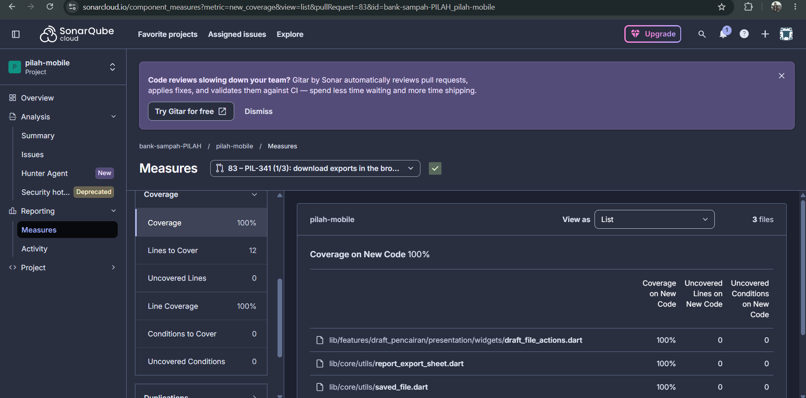
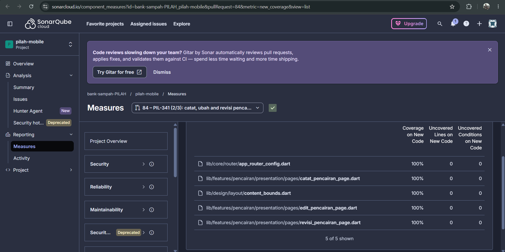

# Test Driven Development

!!! success "Competency level: 4"
    **Level 3 met:** PIL-331 was built test-first on both sides, with `[RED]`/`[GREEN]`/`[REFACTOR]` in every commit subject. Every review finding Tristan raised was fixed the same way, with a failing test first. Changed lines are 100% covered in every MR, generated code included, and each behaviour is tested with positive, negative and corner cases.

    **Level 4:** advanced testing methods in the commits:

    - **Mocks, stubs and fakes for isolation:** mocktail, `Completer`s that decide which request answers first, and a fake backend at the HTTP boundary.
    - **Mutation checks:** tests that passed when written were proven to guard their code by breaking the code and watching them fail.
    - **Full-graph test:** a test builds the app's whole generated dependency graph in both environments.

## Coverage proof at a glance

Every MR this page claims, with SonarCloud's new-code coverage from the MR's last PR analysis and, where I ran it, the local diff-coverage report. The two tools count lines differently: SonarCloud counts executable lines, diff-cover counts changed lines in lcov.

| MR | Work | SonarCloud new-code coverage | Local diff coverage |
|---|---|---|---|
| pilah-be [#92](https://github.com/bank-sampah-PILAH/pilah-be/pull/92) | PIL-331 | [100% of 40 lines](https://sonarcloud.io/component_measures?id=bank-sampah-PILAH_pilah-be&pullRequest=92&metric=new_coverage&view=list) | [100% of 93 lines](evidence/pilah-be-92-diff-coverage.html) |
| pilah-be [#96](https://github.com/bank-sampah-PILAH/pilah-be/pull/96) | Filter allow-list (A03) | [100% of 15 lines](https://sonarcloud.io/component_measures?id=bank-sampah-PILAH_pilah-be&pullRequest=96&metric=new_coverage&view=list) | [100% of 28 lines](evidence/pilah-be-96-diff-coverage.html) |
| pilah-be [#79](https://github.com/bank-sampah-PILAH/pilah-be/pull/79) | PIL-304, after the review fixes | [100% of 144 lines](https://sonarcloud.io/component_measures?id=bank-sampah-PILAH_pilah-be&pullRequest=79&metric=new_coverage&view=list) | [100% of 459 lines](evidence/pilah-be-79-after-review-diff-coverage.html) |
| pilah-mobile [#73](https://github.com/bank-sampah-PILAH/pilah-mobile/pull/73) | PIL-331 | [96.5% of 142 lines](https://sonarcloud.io/component_measures?id=bank-sampah-PILAH_pilah-mobile&pullRequest=73&metric=new_coverage&view=list): the 5 missing lines are generated `di.config.dart`, see [below](#mobile-pil-331-pilah-mobile-73-stacked-on-62) | [100% of 141 lines](evidence/pilah-mobile-73-diff-coverage.html), generated code included |
| pilah-mobile [#62](https://github.com/bank-sampah-PILAH/pilah-mobile/pull/62) | PIL-304, after the review fixes | [100% of 120 lines](https://sonarcloud.io/component_measures?id=bank-sampah-PILAH_pilah-mobile&pullRequest=62&metric=new_coverage&view=list) | [100% of 122 lines](evidence/pilah-mobile-62-after-review-diff-coverage.html) |
| pilah-mobile [#74](https://github.com/bank-sampah-PILAH/pilah-mobile/pull/74) | Generated DI graph | [100% of 6 lines](https://sonarcloud.io/component_measures?id=bank-sampah-PILAH_pilah-mobile&pullRequest=74&metric=new_coverage&view=list) | — |
| pilah-mobile [#83](https://github.com/bank-sampah-PILAH/pilah-mobile/pull/83) | PIL-341 slice 1 (13 Oct) | [100% of 12 lines](https://sonarcloud.io/component_measures?id=bank-sampah-PILAH_pilah-mobile&pullRequest=83&metric=new_coverage&view=list), [screenshot](#pil-341-on-sonarcloud) | — |
| pilah-mobile [#84](https://github.com/bank-sampah-PILAH/pilah-mobile/pull/84) | PIL-341 slice 2 (13 Oct) | [100% of 102 lines](https://sonarcloud.io/component_measures?id=bank-sampah-PILAH_pilah-mobile&pullRequest=84&metric=new_coverage&view=list), [screenshot](#pil-341-on-sonarcloud) | — |

## Backend: PIL-331, [pilah-be #92](https://github.com/bank-sampah-PILAH/pilah-be/pull/92), stacked on #79

| Behaviour | Red | Green |
|---|---|---|
| `GET /jenis-sampah/{id}/harga` lists every version newest first, with price, unit, start and author | [`1f43102`](https://github.com/bank-sampah-PILAH/pilah-be/commit/1f43102) | [`50d9392`](https://github.com/bank-sampah-PILAH/pilah-be/commit/50d9392) |
| Each version is marked `terjadwal`, `berlaku`, `sebelumnya` or `digantikan` (a corrected scheduled price) | [`97a6632`](https://github.com/bank-sampah-PILAH/pilah-be/commit/97a6632) | [`601b948`](https://github.com/bank-sampah-PILAH/pilah-be/commit/601b948) |

**Refactor after green:** [`f0b6b0d`](https://github.com/bank-sampah-PILAH/pilah-be/commit/f0b6b0d) replaces a re-scan with a flag and names the price unit once.

**Pinned, then proven:** [`8bc2be8`](https://github.com/bank-sampah-PILAH/pilah-be/commit/8bc2be8) covers three behaviours:

- another bank's pengurus (404) and a nasabah (403) can't read the history (A01);
- a jenis with no versions has an empty history;
- a backfilled version has no author.

They passed when written, because the endpoint reuses the viewset's scoping. So I broke each piece once (an unscoped lookup; dropping `allow_null`) and watched the tests fail before keeping them.

**Coverage:** **100% of the 93 changed lines** ([report](evidence/pilah-be-92-diff-coverage.html)), 469 tests.

## Backend: review fixes in #79 (12 Oct)

| Behaviour | Red | Green |
|---|---|---|
| A reseeded setoran keeps the price of its own date, not today's | [`857735b`](https://github.com/bank-sampah-PILAH/pilah-be/commit/857735b) | [`f67a84f`](https://github.com/bank-sampah-PILAH/pilah-be/commit/f67a84f) |

- **The red was real:** the test recorded a price change taking effect now, reran the seed, and watched a 3,500 snapshot become 99,999.
- **A covered refactor:** [`dc29a68`](https://github.com/bank-sampah-PILAH/pilah-be/commit/dc29a68) routes the seed's price writes through `catat_harga`; the existing seed tests cover it.
- **Coverage:** #79 after the fixes is **100% of 459 changed lines** ([report](evidence/pilah-be-79-after-review-diff-coverage.html)).

## Mobile: PIL-331, [pilah-mobile #73](https://github.com/bank-sampah-PILAH/pilah-mobile/pull/73), stacked on #62

| Behaviour | Red | Green |
|---|---|---|
| The repository reads a jenis's versions with unit, start, author and status | [`c1088ee`](https://github.com/bank-sampah-PILAH/pilah-mobile/commit/c1088ee) | [`7077e55`](https://github.com/bank-sampah-PILAH/pilah-mobile/commit/7077e55) |
| `RiwayatHargaCubit` loads them, or reports why it couldn't | [`345f853`](https://github.com/bank-sampah-PILAH/pilah-mobile/commit/345f853) | [`35e908a`](https://github.com/bank-sampah-PILAH/pilah-mobile/commit/35e908a) |
| The screen shows each version's price, local start, author and status badge | [`a2a36ba`](https://github.com/bank-sampah-PILAH/pilah-mobile/commit/a2a36ba) | [`cd41645`](https://github.com/bank-sampah-PILAH/pilah-mobile/commit/cd41645) |
| A jenis with no versions shows an empty state | [`4c9a443`](https://github.com/bank-sampah-PILAH/pilah-mobile/commit/4c9a443) | [`328fe5c`](https://github.com/bank-sampah-PILAH/pilah-mobile/commit/328fe5c) |
| A failed load says why and can be retried | [`4544b2b`](https://github.com/bank-sampah-PILAH/pilah-mobile/commit/4544b2b) | [`6621a7d`](https://github.com/bank-sampah-PILAH/pilah-mobile/commit/6621a7d) |
| Each harga card opens its history, not the edit sheet | [`e376a74`](https://github.com/bank-sampah-PILAH/pilah-mobile/commit/e376a74) | [`e4276fd`](https://github.com/bank-sampah-PILAH/pilah-mobile/commit/e4276fd) |
| `/riwayat-harga` without a jenis (a refreshed web tab) falls back to the list instead of crashing | [`afb0795`](https://github.com/bank-sampah-PILAH/pilah-mobile/commit/afb0795) | [`097785a`](https://github.com/bank-sampah-PILAH/pilah-mobile/commit/097785a) |
| *Review, 12 Oct:* a price with sen (3333.99) is shown exactly, not truncated | [`de18bfc`](https://github.com/bank-sampah-PILAH/pilah-mobile/commit/de18bfc) | [`4226ca5`](https://github.com/bank-sampah-PILAH/pilah-mobile/commit/4226ca5) |
| *Review, 12 Oct:* a history longer than one page is read to the end | [`9ad13dd`](https://github.com/bank-sampah-PILAH/pilah-mobile/commit/9ad13dd) | [`510f02a`](https://github.com/bank-sampah-PILAH/pilah-mobile/commit/510f02a) |

**Refactor after green:** [`2eb1bea`](https://github.com/bank-sampah-PILAH/pilah-mobile/commit/2eb1bea) shares one date-and-time formatter with the pencairan revision page.

**Caught by tests:**

- **Button overflow:** at 360 dp the new button overflowed the card by 1.3 px. The existing phone-width test caught it, and the icon was dropped.
- **Route crash leaking:** a routing test showed that the route crashed without a jenis, and that the crash leaked into the next test through the shared router. That became its own red/green pair.

**Coverage:** **100% of the 141 changed lines** ([report](evidence/pilah-mobile-73-diff-coverage.html)), **generated code included**. With the generator's coverage marker dropped, the two registrations #73 adds to `di.config.dart` showed as missing (98%). [`eb9b20f`](https://github.com/bank-sampah-PILAH/pilah-mobile/commit/eb9b20f) (pushed 13 Oct, after the week's full run) builds `RiwayatHargaCubit` through the real graph and covers them.

## Mobile: review fixes in #62 (12 Oct)

| Behaviour | Red | Green |
|---|---|---|
| When only the price fails after the fields saved, the sheet says so and stays open | [`5a80375`](https://github.com/bank-sampah-PILAH/pilah-mobile/commit/5a80375) | [`f1ea8d9`](https://github.com/bank-sampah-PILAH/pilah-mobile/commit/f1ea8d9) |
| An older list reload that answers late can't overwrite a newer one | [`ece524b`](https://github.com/bank-sampah-PILAH/pilah-mobile/commit/ece524b) | [`bd21f70`](https://github.com/bank-sampah-PILAH/pilah-mobile/commit/bd21f70) |

**Coverage:** #62 after the fixes is **100% of 122 changed lines** ([report](evidence/pilah-mobile-62-after-review-diff-coverage.html)), generated code included through [`726df68`](https://github.com/bank-sampah-PILAH/pilah-mobile/commit/726df68) (13 Oct).

## Mobile: the generated DI graph, [pilah-mobile #74](https://github.com/bank-sampah-PILAH/pilah-mobile/pull/74)

SonarCloud showed #62 and #73 a few lines short of 100%. Every missing line was a registration in the generated `di.config.dart`, which the generator marks `coverage:ignore-file`. Covering it for real turned up a bug: CI-built apps could not build `AuthenticationBloc`, because the generated graph asked dependency injection for a `bool`.

- **The crash:** [`af350f0`](https://github.com/bank-sampah-PILAH/pilah-mobile/commit/af350f0) `[RED]` reproduced it, and [`320612b`](https://github.com/bank-sampah-PILAH/pilah-mobile/commit/320612b) `[GREEN]` fixed it. `staging` later got the same fix from Tristan's #71, so #74 now takes `staging`'s version.
- **The whole graph:** [`06ece1b`](https://github.com/bank-sampah-PILAH/pilah-mobile/commit/06ece1b) adds `di_graph_test`, which builds every registration in dev and prod. A second test fails if a new registration is missing from its list.
- **Coverage in CI:** [`941f24d`](https://github.com/bank-sampah-PILAH/pilah-mobile/commit/941f24d) and [`26fcf40`](https://github.com/bank-sampah-PILAH/pilah-mobile/commit/26fcf40) make CI and SonarCloud measure the file instead of excluding it. Result: every executable line of `di.config.dart` is covered (221/221 on 12 Oct).

## Mobile: PIL-341 slices 1 and 2 (13 Oct), [#83](https://github.com/bank-sampah-PILAH/pilah-mobile/pull/83) and [#84](https://github.com/bank-sampah-PILAH/pilah-mobile/pull/84)

PIL-341 brings pencairan to the web dashboard. Slice 1 (#83) downloads exports in the browser. Slice 2 (#84, stacked on #83 and merged into it by Tristan on 15 Oct) records, edits and revises a pencairan on a desktop window.

| Behaviour | Red | Green |
|---|---|---|
| No "Bagikan" (share) after a browser download, for a draft export and for a report | [`36379b5`](https://github.com/bank-sampah-PILAH/pilah-mobile/commit/36379b5), [`298e864`](https://github.com/bank-sampah-PILAH/pilah-mobile/commit/298e864) | [`a1d37de`](https://github.com/bank-sampah-PILAH/pilah-mobile/commit/a1d37de), [`7433830`](https://github.com/bank-sampah-PILAH/pilah-mobile/commit/7433830) |
| An export downloads through the browser on web, tested in real Chrome. The red was shown failing in CI before the implementation | [`1b8b299`](https://github.com/bank-sampah-PILAH/pilah-mobile/commit/1b8b299), [`f11b44b`](https://github.com/bank-sampah-PILAH/pilah-mobile/commit/f11b44b) | [`824f7de`](https://github.com/bank-sampah-PILAH/pilah-mobile/commit/824f7de) |
| The edit and revision routes, opened without their pencairan (after a refresh), go back to the laporan instead of crashing | [`13e8268`](https://github.com/bank-sampah-PILAH/pilah-mobile/commit/13e8268) | [`151154c`](https://github.com/bank-sampah-PILAH/pilah-mobile/commit/151154c) |
| Catat Pencairan puts the saldo and the button in a side panel on desktop | [`128d0e5`](https://github.com/bank-sampah-PILAH/pilah-mobile/commit/128d0e5) | [`19c1d2b`](https://github.com/bank-sampah-PILAH/pilah-mobile/commit/19c1d2b) |
| Edit Pencairan and its revision history stay in a readable column on desktop | [`b13b0e1`](https://github.com/bank-sampah-PILAH/pilah-mobile/commit/b13b0e1) | [`426a8ad`](https://github.com/bank-sampah-PILAH/pilah-mobile/commit/426a8ad) |
| A recorded payout is confirmed in a centred dialog on desktop | [`a221974`](https://github.com/bank-sampah-PILAH/pilah-mobile/commit/a221974) | [`700d123`](https://github.com/bank-sampah-PILAH/pilah-mobile/commit/700d123) |
| The success dialog clips its content to its rounded corners. The bug was caught by the Playwright screenshot run, not by the widget tests | [`05f0d3e`](https://github.com/bank-sampah-PILAH/pilah-mobile/commit/05f0d3e) | [`b6c5efb`](https://github.com/bank-sampah-PILAH/pilah-mobile/commit/b6c5efb) |

**Refactors:** [`bf60b97`](https://github.com/bank-sampah-PILAH/pilah-mobile/commit/bf60b97) put the native file saver behind a platform-neutral entry point before slice 1 began, and [`0d0866a`](https://github.com/bank-sampah-PILAH/pilah-mobile/commit/0d0866a) settled where that entry point lives.

**Coverage:** SonarCloud shows **100% of new code on both** (12 lines on #83, 102 on #84) and no open issue. One file is left out of SonarCloud's coverage on purpose: `file_downloader_web.dart` ([`48cac00`](https://github.com/bank-sampah-PILAH/pilah-mobile/commit/48cac00)). `flutter test --coverage` runs on the Dart VM, which can't compile browser-only `package:web` code, so every line would count as uncovered. The file is covered instead by `file_downloader_web_chrome.dart`, which CI runs in Chrome. The app already handles its web-only Google sign-in button the same way.

### PIL-341 on SonarCloud

{ width="720" }

{ width="720" }

## Positive, negative and corner cases

| Behaviour | Positive | Negative | Corner |
|---|---|---|---|
| Price history (BE) | versions newest first, with status | another bank (404); a nasabah (403) | no versions at all; a backfilled version without an author; two versions on the same start (`digantikan`) |
| Price history (mobile) | rows with price, start, author, badge | failed load, retried | empty history; a status the app doesn't know (read as "sebelumnya"); a price with sen; more than 100 versions; a 360 dp phone; the route without a jenis |
| Saving a price change (#62) | — | the price POST fails after the PUT saved | an older reload answering last |
| Seed rerun (#79) | — | — | a price change made today must not reprice historical setoran |
| DI graph (#74) | every registration builds in dev and prod | a dependency the graph can't provide | a registration missing from the list |

## Advanced testing methods

- **Controlled ordering with `Completer`s (#62).** The race test hands the cubit two pending requests, answers the newer one first and the older one last, and checks the newer price stays.
- **A fake backend at the HTTP boundary (#73).** `StubApi` replaces Dio's adapter, so the real data source, repository, use case and cubit run against canned responses. Failures are injected at the transport level (`api.fail`).
- **Mutation checks (#92, #73).**
    - For the three pinned backend tests, I broke the code they guard and watched each fail.
    - For the unknown-status fallback ([`5123002`](https://github.com/bank-sampah-PILAH/pilah-mobile/commit/5123002)), I replaced the fallback with a hard lookup and watched the test fail.
- **Full-graph resolution (#74).** `di_graph_test` builds every registration of the generated dependency graph. It's the test that would have caught the startup crash before a build shipped.
