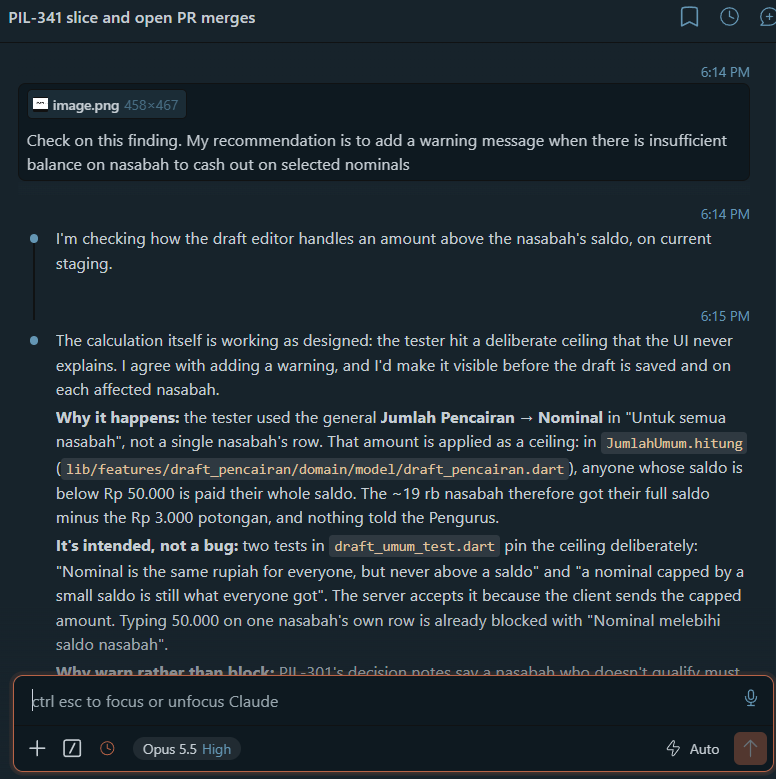
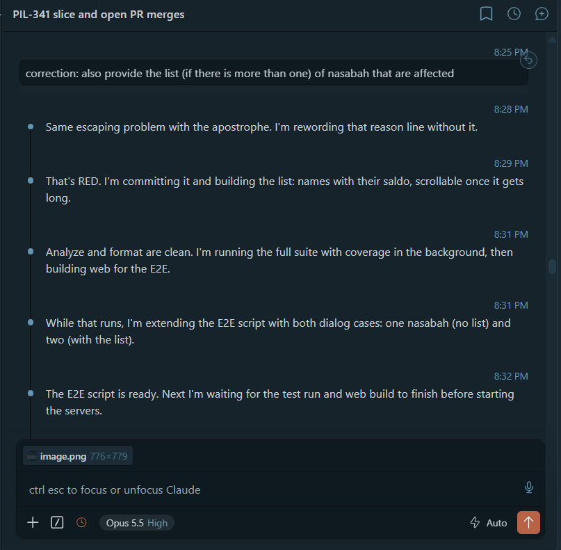
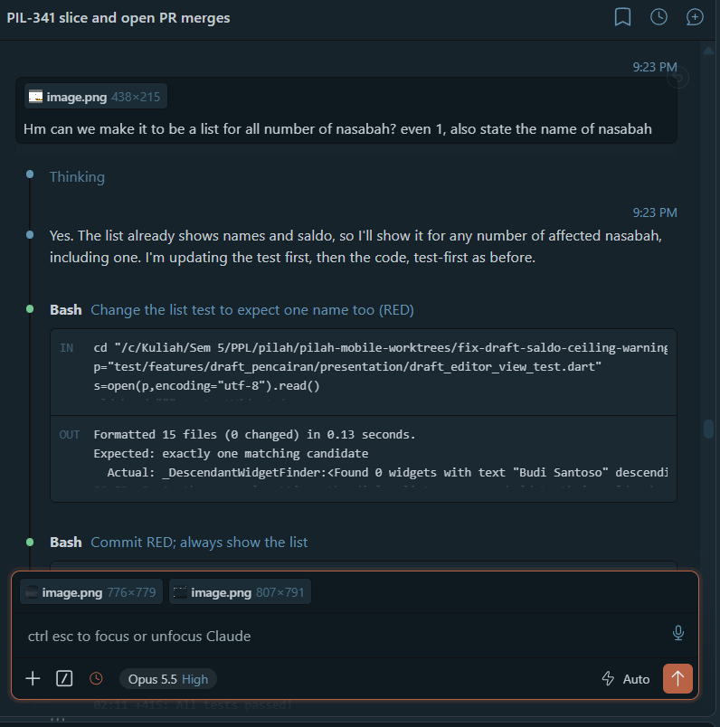

# AI Literacy

!!! success "Competency level: 3"
    AI used critically:

    - Its claims were checked against the code before anything changed.
    - Twice it said one of its own earlier claims was wrong, and changed course.
    - A QA "Fail – High" was traced to a deliberate rule before anyone called it a bug.
    - A check it could not pass was reported as such, not worked around.

    Decisions with team impact were put to me and to the team: whether to warn or block, how far "survives a refresh" should go, and who reviews.

Evidence for this week:

- [Session export](ai-session-export.txt): Claude Code's own `/export` of the session behind 17–23 Oct, with tool output collapsed as the export shows it. Local home-folder paths are shortened to `~`; nothing else is changed. Before publishing I checked it for tokens, keys, emails, phone numbers and teammates' Discord IDs, and found none.
- Screenshots of the 21 Oct conversation about the QA finding on draft pencairan, [below](#example-a-qa-fail-that-was-a-rule-not-a-bug).

## How AI was used this week

- **Tool:** Claude Code as an agent in VS Code across `pilah-be`, `pilah-mobile` and `pilah-docs`; Linear through Composio; GitHub through `gh`; SonarCloud's API; Playwright against local web builds.
- **Guardrails:**
    - the workspace skills (`ship`, `tdd`, `multi-lgtm`, `ask-for-review`, `ask-for-qa`);
    - CI's own commands, run locally before every push;
    - rules kept in memory: phase-tagged commits, 100% coverage of changed code, Playwright E2E for web UI, OWASP categories named in commits.
    - **New this week:**
        - I may merge my own PRs once approved (17 Oct; until then only the lead dev merged).
        - Validate any id read from a URL, after finding that go_router's `push` never writes to the URL.
        - `agent-device`, for future native-mobile E2E.
- **My role:**
    - choosing PIL-341 slice 3's scope (dialogs from tablet width; a draft link that opens on its own);
    - deciding warn-not-block for the QA finding, after a team discussion;
    - refining the confirmation's list (first for several nasabah, then for every nasabah);
    - choosing reviewers;
    - granting merge permission.

## Where verification changed the outcome

| Situation | What happened |
|---|---|
| *17 Oct:* I asked it to resolve conflicts and merge my 8 approved PRs | The permission check blocked the merges. It **stopped and asked**, and made no attempt to get around the block. Its saved rule said the lead dev merges, so it named that conflict and let me change the rule. |
| *17 Oct:* A worktree held an unfinished merge from an earlier session | It **reviewed that session's conflict resolution against both sides** before completing it, instead of aborting it or trusting it blindly. |
| *17 Oct:* Merging staging into PIL-341 (#83) | It found that a teammate's PIL-248 (#91) had already shipped the same browser download as slice 1. It **kept the teammate's version**, which shares the file instead of hiding Bagikan, rather than overriding their choice. It said so in #83's description. |
| *17 Oct:* Its own temporary test copies ended up in a local merge commit | It **caught this before pushing** and rewrote only the unpushed commits, so nothing reached GitHub. |
| *17 Oct:* Slice 3: "a saved draft survives a refresh" | Its recommendation assumed the URL changes on `push`. While writing the test it found that go_router never writes `push` to the URL. It **reverted the test, said its recommendation was wrong**, and asked how far to go. I chose link-open only. |
| *17 Oct:* The new `?id=` link | It noticed that the id goes straight into request paths, so `?id=../nasabah` could steer the Pengurus's own authenticated requests elsewhere. It **added a guard test-first**, naming OWASP A01 and A03. |
| *21 Oct:* QA "Fail – High": a Rp 50.000 Nominal paid a Rp 19 rb saldo | It traced the cause to a deliberate ceiling, pinned by two tests, and **said it was a missing explanation, not a calculation bug**. It weighed warning against blocking, citing PIL-301's "don't fail the others", and drafted a proposal for the team. [Screenshots below](#example-a-qa-fail-that-was-a-rule-not-a-bug). |
| *21 Oct:* QA finding 2: "Edit Pencairan only lets me change keterangan" | It first said the Tanggal picker still opened on a locked pencairan. While writing that test, it found an existing guard and test. It **corrected itself to me**, re-scoped PIL-375 to what actually confused QA (a Tanggal field that looked tappable, a note that didn't mention it), and rewrote the issue. |
| *21 Oct:* Playwright on the desktop dialog | The dialog's title never reached Flutter's semantics tree, only its buttons. It **logged that as INFO with a screenshot** instead of marking a pass, and noted it in the PR as a likely accessibility gap in the shared dialog. |
| *21 Oct:* SonarCloud S3776 (complexity 17 of 15) | The dialog had made `_terapkan` too complex. It extracted the confirmation into its own method as a `[REFACTOR]` commit, and the issue cleared. |
| *21 Oct:* Aldo's review of #153 and #154 | Both nits were **checked against the code before replying or merging**. Both held, and neither needed a change. |

## Example: a QA "Fail" that was a rule, not a bug

QA marked draft pencairan "Fail – High": a nasabah had about Rp 19 rb saldo, the tester set Jumlah Pencairan to Rp 50.000 and a Rp 3.000 potongan, and the draft still paid out. My first guess was a missing balance check, and I suggested a warning.

**1. "Check on this finding."** It did not start with my fix. It found that the tester had used the general Nominal, which is a *ceiling*: anyone with less saldo is paid their whole saldo. Two tests pin that on purpose, and a per-nasabah nominal above saldo is already blocked. So the bug was that **nothing told the Pengurus**. It agreed with a warning, and argued against blocking with the team's own PIL-301 note.

{ width="620" }

**2. The team decided, then I refined it.** The proposal went to the team as a doc. We chose to warn without blocking, and Pascal asked for a confirmation dialog on Terapkan. While it built that, I added a correction: list the affected nasabah when there is more than one. It took the correction mid-task and went on test-first.

{ width="620" }

**3. "Even 1, and state the name."** After seeing the one-nasabah dialog, I asked for the list every time. It changed the test first (red), then the code, and reran the Playwright checks for both one and two nasabah.

{ width="620" }

**What changed.** A "Fail – High" that looked like a missing validation became a small UX fix the team agreed on: [pilah-mobile #153](https://github.com/bank-sampah-PILAH/pilah-mobile/pull/153) ([PIL-374](https://linear.app/pilah-2/issue/PIL-374)). It shows a note under the Nominal, a confirmation that names every affected nasabah and their saldo, and a line on each capped card. The rule the tests pin stayed as it was, and the reason behind it is now on screen.
