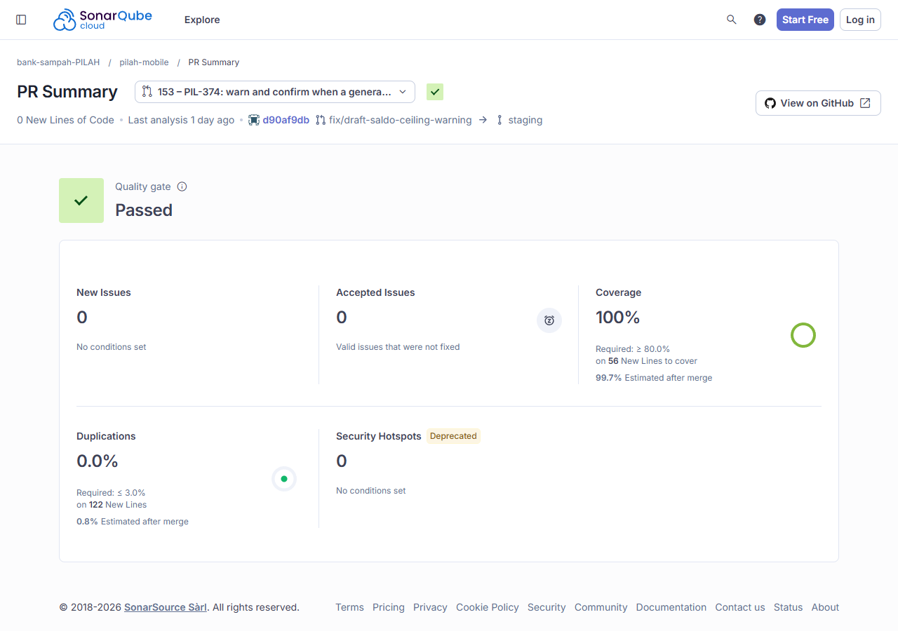

# Code Quality

!!! success "Competency level: 3"
    No open SonarCloud issue on any of this week's three merge requests, and the quality gate passed on all three. Coverage on new code is 100% on each.

    One issue did appear while #153 was open: a cognitive-complexity finding on code I had just written. I fixed it with a refactor before review. SonarCloud closed it, and the [history](#an-issue-found-and-fixed-before-review) shows it.

## SonarCloud, per merge request

| Scope | Open issues | New-code coverage | Duplication on new code | Security hotspots |
|---|---|---|---|---|
| pilah-mobile [#153](https://github.com/bank-sampah-PILAH/pilah-mobile/pull/153) (PIL-374) | 0 | 100% of 56 lines | 0.0% | 0 |
| pilah-mobile [#154](https://github.com/bank-sampah-PILAH/pilah-mobile/pull/154) (PIL-375) | 0 | 100% of 5 lines | 0.0% | 0 |
| pilah-mobile [#127](https://github.com/bank-sampah-PILAH/pilah-mobile/pull/127) (PIL-341 slice 3, 17 Oct) | 0 | 100% of 80 lines | — | — |

Read from the SonarCloud API on 23 Oct (`api/issues/search` and `api/measures/component` with `pullRequest=<n>`). Screenshots of the #153 and #154 summaries are on the [TDD page](tdd.md#on-sonarcloud).

{ width="620" }

## An issue found and fixed before review

On 21 Oct, after the confirmation dialog and its list went into #153, SonarCloud reported:

| Rule | Severity | Where | Opened | Closed |
|---|---|---|---|---|
| `dart:S3776` Cognitive Complexity | Critical | `_terapkan` in `draft_editor_page.dart`: "reduce its Cognitive Complexity from 17 to the 15 allowed" | 21 Oct, 20:30 WIB | 21 Oct, 21:24 WIB, **fixed** |

The method had grown to hold two jobs: deciding whether to ask, and applying the settings. I did not suppress the rule or raise the threshold. The fix was an Extract Method refactor, [`450bf39`](https://github.com/bank-sampah-PILAH/pilah-mobile/commit/450bf39) (details on the [Programming page](programming.md#asking-and-applying-split-450bf39)):

- `_setujuSaldoKurang` asks for confirmation;
- `_terapkan` only applies.

The same tests stayed green, and the next analysis closed the issue as fixed. I requested reviewers only after the fix was pushed.

## Local checks before every push

These are the commands CI runs, run locally first on each branch:

```console
$ dart format --output=none --set-exit-if-changed lib test codegen   # 0 changed
$ flutter analyze --fatal-infos                                      # no issues
$ flutter test --coverage                                            # same 25 Windows-only failures as staging, nothing new
$ diff-cover coverage/lcov.info --compare-branch=origin/staging      # 100% of changed lines
```

The 25 local failures are tests that compare file paths with `/` and so fail only on Windows: 19 of the team's design-rule tests and 6 profile-logo tests. They fail the same way on `staging`. To still check the design rules locally, I ran copies of all 54 design tests with Windows paths normalised to `/`. All pass on both branches, so neither fix adds a raw colour, font size, radius or stock widget the team's ratchets forbid.
