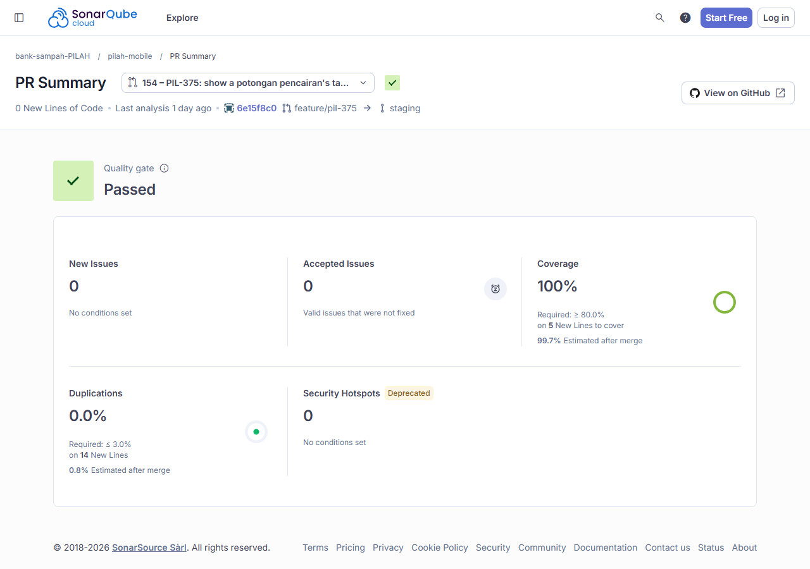

# Test Driven Development

!!! success "Competency level: 4"
    **Level 3 met:** both QA fixes were built test-first, one behaviour per `[RED]` → `[GREEN]` pair, with the phase in every commit subject and `[REFACTOR]` commits after green. Every changed line is covered (100% on SonarCloud for both MRs). The tests cover the positive case, the negative case (nothing shown or applied) and the corner cases (exactly one affected nasabah, Persen instead of Nominal, a hand-typed nominal).

    **Level 4:** advanced testing methods in the commits:

    - **Mocks for isolation:**
        - #153's tests run the real `DraftEditorCubit` on a mocktail `_MockRepository`, a fake `DraftPencairanRepository`, so no server is involved and the tests assert what the cubit holds.
        - #154's tests use a mocked `PencairanUseCases`, and `verify(… captureAny())` captures the request to check that a locked pencairan still sends its nominal and tanggal exactly as recorded.
    - **Viewport-driven tests:** the test view is resized to phone and desktop, so one test drives each adaptive layout.
    - **Proven guards:** a test that passed when written is shown to guard its code, and a changed test is shown red before the code follows.
    - **E2E through Flutter's semantics tree:** Playwright, at desktop and phone sizes, against a local build and backend.

## Coverage proof at a glance

| MR | Work | SonarCloud new-code coverage | Local diff coverage |
|---|---|---|---|
| pilah-mobile [#153](https://github.com/bank-sampah-PILAH/pilah-mobile/pull/153) | PIL-374: saldo warning and confirmation | [100% of 56 lines](https://sonarcloud.io/component_measures?id=bank-sampah-PILAH_pilah-mobile&pullRequest=153&metric=new_coverage&view=list), [screenshot](#on-sonarcloud) | 100% of 56 changed lines |
| pilah-mobile [#154](https://github.com/bank-sampah-PILAH/pilah-mobile/pull/154) | PIL-375: locked Tanggal | [100% of 5 lines](https://sonarcloud.io/component_measures?id=bank-sampah-PILAH_pilah-mobile&pullRequest=154&metric=new_coverage&view=list), [screenshot](#on-sonarcloud) | 100% of 5 changed lines |

The local figures come from `diff-cover coverage/lcov.info --compare-branch=origin/staging` after `flutter test --coverage`. They are recorded in each PR's Testing section.

## PIL-374: warn when a general Nominal is above a nasabah's saldo — [pilah-mobile #153](https://github.com/bank-sampah-PILAH/pilah-mobile/pull/153)

The QA finding was "a Rp 50.000 Nominal paid a Rp 19 rb saldo". The ceiling that does that is intended and stays. These tests make it visible.

| Behaviour | Red | Green |
|---|---|---|
| A note under the Nominal says how many nasabah it holds to their saldo: none at Rp 40.000, one at Rp 100.000, none for Persen; Terapkan stays enabled | [`3794f95`](https://github.com/bank-sampah-PILAH/pilah-mobile/commit/3794f95) | [`0511e1b`](https://github.com/bank-sampah-PILAH/pilah-mobile/commit/0511e1b) |
| After Terapkan, only the capped nasabah's card says "Saldo tidak cukup untuk …"; a hand-typed nominal clears it | [`b99dff3`](https://github.com/bank-sampah-PILAH/pilah-mobile/commit/b99dff3) | [`bcde54e`](https://github.com/bank-sampah-PILAH/pilah-mobile/commit/bcde54e) |
| Terapkan asks first; Batal applies nothing, "Ya, terapkan" applies | [`86427cb`](https://github.com/bank-sampah-PILAH/pilah-mobile/commit/86427cb) | [`416ac45`](https://github.com/bank-sampah-PILAH/pilah-mobile/commit/416ac45) |
| The confirmation lists the affected nasabah by name and saldo, and only them | [`b49e031`](https://github.com/bank-sampah-PILAH/pilah-mobile/commit/b49e031) | [`b5c6b79`](https://github.com/bank-sampah-PILAH/pilah-mobile/commit/b5c6b79) |
| Review feedback: list them even when there is only one | [`6e5b9d5`](https://github.com/bank-sampah-PILAH/pilah-mobile/commit/6e5b9d5) | [`d90af9d`](https://github.com/bank-sampah-PILAH/pilah-mobile/commit/d90af9d) |

**Refactor after green:**

- [`42dd487`](https://github.com/bank-sampah-PILAH/pilah-mobile/commit/42dd487) put a doc comment back on the method it describes.
- [`450bf39`](https://github.com/bank-sampah-PILAH/pilah-mobile/commit/450bf39) extracted the confirmation from `_terapkan`, after SonarCloud flagged its complexity ([Code Quality](code-quality.md)). The same tests stayed green.

**Each red failed for the right reason:**

- The note test failed on "no element" (no note yet).
- The dialog test failed on the missing title "Terapkan Nominal Rp 100.000?".
- The one-nasabah list test failed on "found 0 widgets with text Budi Santoso".

These runs are in the [session export](ai-session-export.txt).

**Proven guards.** "A Nominal every saldo covers applies without asking" went in with the dialog's red commit and passed from the start. It is a guard: it fails if the dialog ever shows when nobody is short.

**Positive, negative and corner cases:** see [the table below](#positive-negative-and-corner-cases).

**Existing tests kept on the real flow.** The shared `_terapkanUmum` helper now confirms the dialog when it appears, so older tests that apply Rp 100.000 still go through it. They don't bypass it.

## PIL-375: show a potongan pencairan's Tanggal as locked — [pilah-mobile #154](https://github.com/bank-sampah-PILAH/pilah-mobile/pull/154)

| Behaviour | Red | Green |
|---|---|---|
| For a pencairan with a potongan, the Tanggal field is disabled (`InputDecorator.decoration.enabled == false`) with no `onTap`, and the note names both locked fields | [`69e50ce`](https://github.com/bank-sampah-PILAH/pilah-mobile/commit/69e50ce) | [`6e15f8c`](https://github.com/bank-sampah-PILAH/pilah-mobile/commit/6e15f8c) |

**What the tests assert.** They check the widget's own state, the disabled decoration and the nulled tap handler. A text lookup alone would pass even if the field still looked tappable.

**Negative case, kept from the existing suite:** a pencairan without a potongan still opens the date picker (see [the table below](#positive-negative-and-corner-cases)).

**An honest note on this one.** While planning the fix, I first assumed the picker still opened on a locked pencairan. Writing the red test showed an existing guard (`_pickTanggal` returns early) and an existing test for it. So the issue was re-scoped to what QA actually saw, a field that looked tappable, before any code changed.

## Positive, negative and corner cases

The examples use the editor tests' three nasabah: Ahmad (saldo Rp 465.600), Budi (Rp 50.000) and Citra (Rp 250.000).

| Behaviour | Positive | Negative | Corner |
|---|---|---|---|
| Note under the general Nominal (#153) | Rp 100.000: "1 nasabah saldonya di bawah Rp 100.000. Mereka dicairkan seluruh saldonya." | Rp 40.000, which every saldo covers: no note | Persen: no note, because a share never exceeds a saldo |
| Confirmation on Terapkan (#153) | Rp 100.000 asks first; "Ya, terapkan" applies (`[100000, 50000, 100000]`) | Batal applies nothing (`[465600, 50000, 250000]`); Rp 40.000 applies without asking | — |
| List in the confirmation (#153) | Rp 300.000 lists Budi and Citra, each with "Saldo Rp …" | Ahmad, whose saldo covers it, is not listed | Exactly one nasabah affected (Rp 100.000): Budi is still listed, Citra isn't |
| Line on each capped card (#153) | Budi's card: "Saldo tidak cukup untuk Rp 100.000, dicairkan Rp 50.000" | Ahmad's and Citra's cards: no line | A nominal typed by hand on Budi's card clears his line |
| Locked Tanggal (#154) | A pencairan with a potongan: Tanggal disabled with no `onTap`, and the note names nominal and tanggal | A pencairan without a potongan: Tanggal still opens the date picker | A locked pencairan still saves a metode change, sending its nominal and tanggal exactly as recorded (checked through the captured use-case call) |

## E2E (Playwright) on both fixes

Run on 21 Oct against `flutter build web --profile` and a local backend seeded with `seed_testing_data`, at 1440×900 and 390×844. The checks are driven through Flutter's semantics tree, wait on labels and assert outcomes. The results and screenshots are in [#153](https://github.com/bank-sampah-PILAH/pilah-mobile/pull/153) and [#154](https://github.com/bank-sampah-PILAH/pilah-mobile/pull/154).

- **#153, every check passes at both sizes:**
    - the note before Terapkan;
    - the confirmation, with no change on Batal;
    - only the capped card marked;
    - the list with one and with two nasabah.

    One desktop check is recorded as INFO rather than a pass: the dialog's title doesn't reach the semantics tree. The screenshot and the widget test cover it.
- **#154, at both sizes:**
    - with a potongan, the note names both fields and tapping Tanggal opens nothing;
    - without one, Tanggal still opens the picker.

## On SonarCloud

{ width="620" }

{ width="620" }
