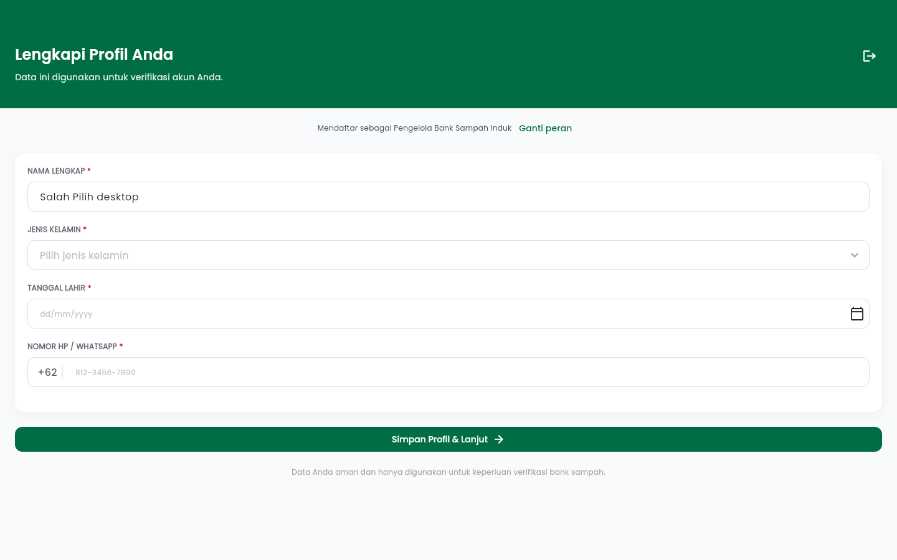
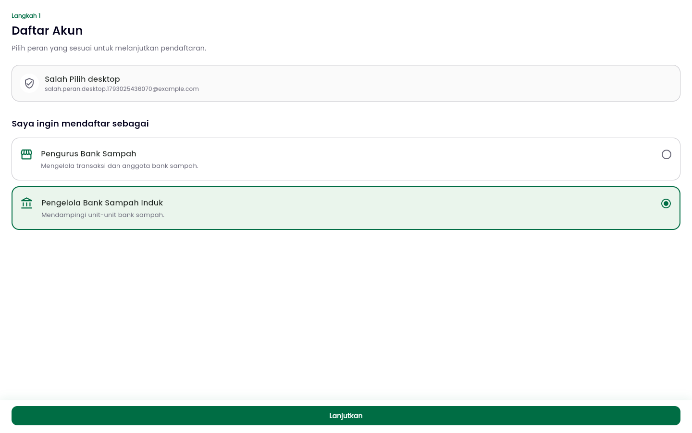
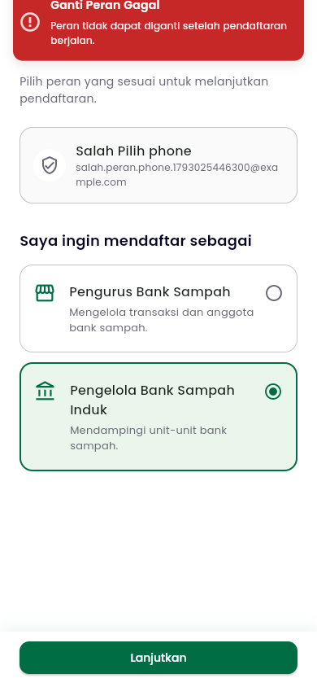
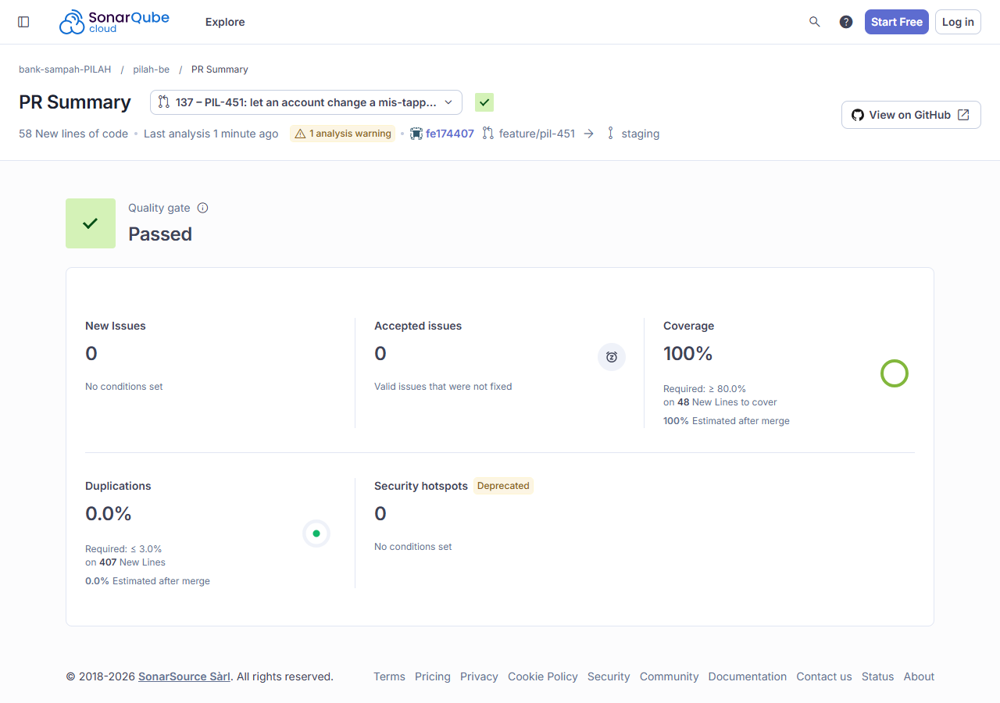
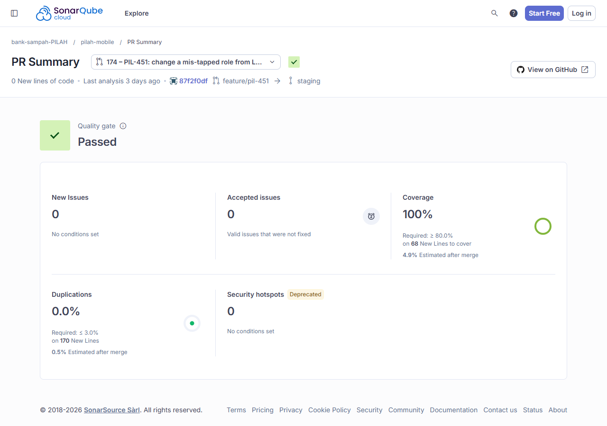

# Test Driven Development

!!! success "Competency level: 4"
    **Level 3 met:** both PIL-451 MRs were built test-first, one behaviour per `[RED]` → `[GREEN]` pair, with the phase in every commit subject and `[REFACTOR]` commits only after green. Every changed line is covered: 100% on SonarCloud for both MRs, 48 and 68 new lines. The tests cover the positive case, the negative cases (each refusal) and the corner cases (a stale account object, re-picking the same role, a malformed response).

    **Level 4:** advanced testing methods in the commits:

    - **Mocks and fakes for isolation:**
        - the mobile data layer runs the real `AuthRepositoryImpl` on mocktail mocks of its remote and local data sources;
        - `captureAny` captures the stored tokens to prove the *new* session is the one saved.
        - The notifier tests run the real `AuthenticationNotifier` on a mocked `LoginWithGoogleUseCase`. Page tests use a fake notifier that records `changeRole` and answers with a configured refusal or session.
    - **A real race, made deterministic:** a `TransactionTestCase` on PostgreSQL runs each registration in one thread, pausing right after its role check, and a role change in another. It's been checked both ways: all three paths fail without the row lock, and pass with it.
    - **Guards proven by mutation:** two tests passed when written. For each, I broke the code it guards, watched it fail, and reverted.
    - **E2E with database assertions:** Playwright drives the web build through Flutter's semantics tree at desktop and phone sizes, then checks the backend's database for the stored role and the audit row.

## Coverage proof at a glance

| MR | Work | SonarCloud new-code coverage | Local diff coverage |
|---|---|---|---|
| pilah-be [#137](https://github.com/bank-sampah-PILAH/pilah-be/pull/137) | PIL-451: `PATCH /onboarding/role` | [100% of 48 lines](https://sonarcloud.io/component_measures?id=bank-sampah-PILAH_pilah-be&pullRequest=137&metric=new_coverage&view=list), [screenshot](#on-sonarcloud) | 100% of the changed lines (tests included), on Postgres 16, re-run after the review fixes |
| pilah-mobile [#174](https://github.com/bank-sampah-PILAH/pilah-mobile/pull/174) | PIL-451: "Ganti peran" and the role page | [100% of 68 lines](https://sonarcloud.io/component_measures?id=bank-sampah-PILAH_pilah-mobile&pullRequest=174&metric=new_coverage&view=list), [screenshot](#on-sonarcloud) | 100% of 70 changed lines |

The local figures come from `diff-cover` against `origin/staging`, after `coverage run manage.py test` (backend) and `flutter test --coverage` (mobile). For #174, SonarCloud's first run showed 97.1%. The PR's CI runs only the changed test files, and two pre-existing lines next to my insertions counted as new; [`b2344b5`](https://github.com/bank-sampah-PILAH/pilah-mobile/commit/b2344b5) covered them in the files CI runs. Details on the [Code Quality page](code-quality.md).

## Backend: [pilah-be #137](https://github.com/bank-sampah-PILAH/pilah-be/pull/137)

| Behaviour | Red | Green | The red failed on |
|---|---|---|---|
| An unfinished account switches role, and the new access token names the new role | [`a23ba21`](https://github.com/bank-sampah-PILAH/pilah-be/commit/a23ba21) | [`13c1a44`](https://github.com/bank-sampah-PILAH/pilah-be/commit/13c1a44) | 404: no route yet |
| The role stays (409 `role_locked`) once the profile is complete, a bank sampah exists (pending included), or a membership is linked | [`e227286`](https://github.com/bank-sampah-PILAH/pilah-be/commit/e227286) | [`52f087f`](https://github.com/bank-sampah-PILAH/pilah-be/commit/52f087f) | Two cases switched with 200. The linked member hit `User.clean`'s `ValidationError`, an unhandled 500 |
| Each change is recorded in `user_role_change_log`; a refusal or a re-pick of the same role writes nothing | [`62e79e1`](https://github.com/bank-sampah-PILAH/pilah-be/commit/62e79e1) | [`2c591c5`](https://github.com/bank-sampah-PILAH/pilah-be/commit/2c591c5) | `'User' object has no attribute 'role_change_logs'` |
| **Review P1:** a role change during a bank registration, a membership application or an invite acceptance waits for it, then refuses (`role_locked`) | [`f4b663d`](https://github.com/bank-sampah-PILAH/pilah-be/commit/f4b663d) | [`df45397`](https://github.com/bank-sampah-PILAH/pilah-be/commit/df45397) | All three paths: `{'changed': True, 'waited_for_registration': False}`. The role flipped under a registration, which then linked a bank to a nasabah, or hit an unhandled `ValidationError` (membership) |

**Refactor after green:** [`fe17440`](https://github.com/bank-sampah-PILAH/pilah-be/commit/fe17440) makes the race test record its outcome on both paths. The "change went through" branch could only run while the bug existed, so diff-cover showed the test at 98.6%. I re-ran the reworked test against the pre-fix services, and all three cases still fail there.

**Guard tests, proven by mutation.** Both passed when written, so there was no red phase. I mutated the code, watched each test fail, then reverted. The mutations are recorded in the commit bodies:

- [`cafba5a`](https://github.com/bank-sampah-PILAH/pilah-be/commit/cafba5a), who may change a role: anonymous gets 401, superadmin 403, and asking to become superadmin 422.
    - With `IsAuthenticated` in place of `IsRegistrationRole`, the test failed with 200: the superadmin had switched itself to nasabah.
    - With every role allowed in the serializer, it failed with 200: a nasabah had become superadmin.
- [`bf3a529`](https://github.com/bank-sampah-PILAH/pilah-be/commit/bf3a529), the race. The account is loaded, then a bank sampah is registered, then the role change runs on the stale object. A check-then-save version failed with "AuthServiceError not raised": the pengelola was switched to nasabah.

```python title="apps/authentication/test_role_change.py"
def test_a_bank_registered_after_the_account_was_loaded_still_keeps_the_role(self) -> None:
    user = self._fresh(User.Role.PENGELOLA)
    # Loaded by this request before a parallel one registered a bank sampah.
    stale = User.objects.get(pk=user.pk)
    bank = BankSampah.objects.create(
        nama="Bank Baru",
        alamat="Depok",
        no_hp_pic="+628111111111",
        status=BankSampah.Status.PENDING,
    )
    User.objects.filter(pk=user.pk).update(bank_sampah=bank)

    with self.assertRaises(AuthServiceError) as refused:
        AuthService.change_role(stale, User.Role.NASABAH)

    self.assertEqual(refused.exception.code, "role_locked")
    user.refresh_from_db()
    self.assertEqual(user.role, User.Role.PENGELOLA)
```

**A wrong assumption in my own test, corrected.** I first wrote that asking for superadmin returns 400. This API's exception handler answers validation errors with 422 `{"errors": …}`, so I fixed the test to the project's convention. The code was right.

**What review added.** Tristan showed that this test proves only one side of the race. It pre-links the bank, so a registration whose role check ran *before* the role change was never exercised. The P1 race test above does exercise it, with real threads and row locks:

```python title="tests/regression/identity/test_role_change_race.py"
with patch.object(owner, method, paused):
    a = threading.Thread(target=registration, name="registration")
    a.start()
    self.assertTrue(reached.wait(WAIT), "registration never reached its write")
    b = threading.Thread(target=role_change, name="role-change")
    b.start()
    b.join(1.0)
    outcome["waited_for_registration"] = b.is_alive()
    proceed.set()
    a.join(WAIT)
    b.join(WAIT)
```

Thread A's registration pauses inside its write, after the role check. Thread B's role change must still be blocked a second later, which is only possible if both take the same row lock. Then A finishes, and B must come back with `role_locked`.

His **P2** asked for success tests for every Google role, not just nasabah. [`d83b0c1`](https://github.com/bank-sampah-PILAH/pilah-be/commit/d83b0c1) switches to each registration role from a different one. It passed as written, so I proved it with a mutation: with `pengelola_induk` removed from the serializer, its case failed with 422.

## Mobile: [pilah-mobile #174](https://github.com/bank-sampah-PILAH/pilah-mobile/pull/174)

| Behaviour | Red | Green | The red failed on |
|---|---|---|---|
| The data layer PATCHes `onboarding/role`, stores the new session, and keeps the old one on a 409 | [`8ef4514`](https://github.com/bank-sampah-PILAH/pilah-mobile/commit/8ef4514) | [`f8214e3`](https://github.com/bank-sampah-PILAH/pilah-mobile/commit/f8214e3) | Compile error: `changeRole` isn't defined |
| The notifier switches to the new session, or returns the server's reason and keeps the old one | [`79f95a9`](https://github.com/bank-sampah-PILAH/pilah-mobile/commit/79f95a9) | [`778cad5`](https://github.com/bank-sampah-PILAH/pilah-mobile/commit/778cad5) | Compile error: `changeRole` isn't defined |
| The role page serves a signed-in account: its identity without "Ganti akun", its role preselected, the change made, the draft dropped, a refusal shown; an account past the profile step still goes to login | [`a0b8fd0`](https://github.com/bank-sampah-PILAH/pilah-mobile/commit/a0b8fd0) | [`9517dbd`](https://github.com/bank-sampah-PILAH/pilah-mobile/commit/9517dbd) | `Found 0 widgets with text "Daftar Akun"`: the page sent every account without a registration token to login |
| Lengkapi Profil names the role and links to change it; the link is hidden once a bank sampah exists or in invite mode; the form redraws for a new role | [`9e83120`](https://github.com/bank-sampah-PILAH/pilah-mobile/commit/9e83120) | [`a1b49bd`](https://github.com/bank-sampah-PILAH/pilah-mobile/commit/a1b49bd) | No label. I also ran the redraw test with the label assertion removed, and it still failed: the screen kept the pengurus stepper. So that test proves the redraw, not just the label |

**Refactor after green:**

- [`2589b0b`](https://github.com/bank-sampah-PILAH/pilah-mobile/commit/2589b0b) turned the role page's nested-ternary `onPressed` into `_submit`.
- [`87f2f0d`](https://github.com/bank-sampah-PILAH/pilah-mobile/commit/87f2f0d) moved the role-note rule out of `build`, after SonarCloud's S3776 finding.

The same tests passed before and after each.

**Coverage tests, added after the behaviour was in place:**

- [`d3d3dba`](https://github.com/bank-sampah-PILAH/pilah-mobile/commit/d3d3dba): the preview session's `changeRole`.
- [`c578399`](https://github.com/bank-sampah-PILAH/pilah-mobile/commit/c578399): a malformed 2xx body becomes a `Left` instead of crashing.
- [`b2344b5`](https://github.com/bank-sampah-PILAH/pilah-mobile/commit/b2344b5): `getMe` and `saveToken`.

The mock with captured arguments, from the data-layer test:

```dart title="test/features/authentication/data/auth_repository_impl_test.dart"
test('stores the session issued for the new role', () async {
  when(() => remote.changeRole('nasabah')).thenAnswer(
    (_) async => <String, dynamic>{
      'access_token': 'access-new',
      'refresh_token': 'refresh-new',
      'user': {
        'id': 'user-1',
        'name': 'Ayu',
        'email': 'ayu@example.com',
        'role': 'nasabah',
      },
      'next_step': 'complete_profile',
    },
  );
  when(() => local.saveToken(any())).thenAnswer((_) async {});

  final result = await repo.changeRole(GoogleRegistrationRole.nasabah);

  final auth = result.getOrElse(() => throw 'expected a session');
  expect(auth.role, 'nasabah');
  expect(auth.nextStep, 'complete_profile');
  final saved = verify(() => local.saveToken(captureAny())).captured.single
      as SaveTokenRequest;
  expect(saved.accessToken, 'access-new');
  expect(saved.refreshToken, 'refresh-new');
});
```

## Positive, negative and corner cases

| Behaviour | Positive | Negative | Corner |
|---|---|---|---|
| Role change, backend (#137) | Each registration role reached from another (nasabah → pengelola, pengelola → pengelola_induk, pengelola_induk → nasabah): 200, `next_step` `complete_profile`, token role matching | Profile complete, a bank sampah (pending), or a linked membership: 409 and the role unchanged. Anonymous: 401. Superadmin caller: 403. Asking for superadmin: 422 | A registration in progress in another thread: the change waits, then gets 409. The account loaded before a bank was registered: still 409. Re-picking the current role: 200 with no log row. The linked member used to get a 500 |
| Audit log (#137) | pengelola → nasabah writes one row (`from_role`, `to_role`, `created_at`) | A refused change writes nothing | A re-pick of the same role writes nothing |
| Data layer (#174) | Stores the new access and refresh tokens and maps the user | 409: the server's message is shown, and no token is saved | A malformed 2xx body returns a failure instead of crashing |
| Role page (#174) | Pick Nasabah → `changeRole`, the profile draft dropped, then `/complete-profile` | A refusal: "Ganti Peran Gagal" with the reason; the page and the draft stay | An account past the profile step is sent to login |
| Lengkapi Profil (#174) | "Mendaftar sebagai Pengurus Bank Sampah" with "Ganti peran", which opens the role page | Hidden once a bank sampah exists, and in invite mode | When the session switches to nasabah, the stepper becomes "Pilih Bank Sampah" |

## E2E (Playwright)

Run on 26 Oct against `flutter build web --profile` and a local backend from #137, with a fresh account for each run. The demo login's email was rewritten in flight, so the backend asks for a role as it would for a new Google account. All **14/14 checks pass** at 1440×900 and 390×844:

1. A new account is asked for a role. It taps Pengelola Bank Sampah Induk, and the role is saved.
2. Lengkapi Profil reads "Mendaftar sebagai Pengelola Bank Sampah Induk".
3. "Ganti peran" opens the role page for the signed-in account, without "Ganti akun".
4. Switching to Pengurus shows the Pengurus form ("Data Bank Sampah").
5. **The database** holds role `pengelola` and one log row, `pengelola_induk → pengelola`.
6. The profile is then completed elsewhere, and Ganti peran is tried again. The page shows "Ganti Peran Gagal" with the server's reason and stays on the role page.
7. **The database** still holds role `pengelola`, still with one log row.

{ width="620" }

{ width="620" }

{ width="220" }

## On SonarCloud

{ width="620" }

{ width="620" }
