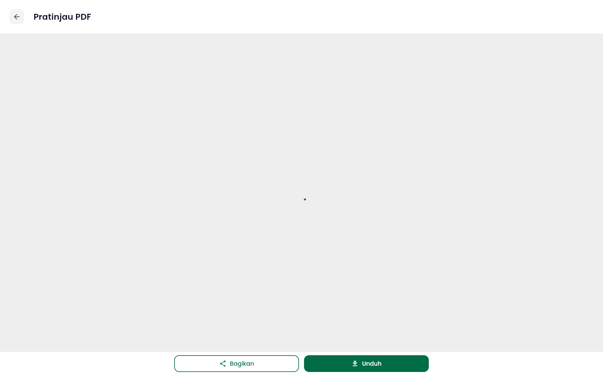
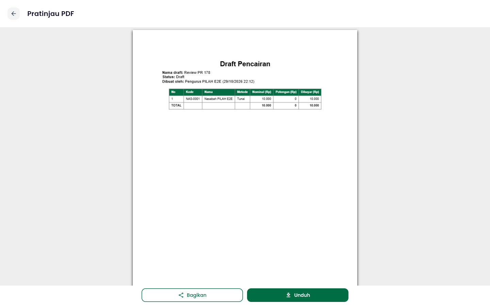

# Team Development Management

!!! success "Competency level: 3"
    A detailed review of **Pascal's pilah-mobile #178** (29 Oct), which adds HSTS and a real Content-Security-Policy to the web image. It answers the check his description asked for, a signed-in click-through, which he couldn't do himself:

    - verified signed in under the PR's exact headers, against a control build without them: 8 pages clean;
    - one regression found (the draft PDF preview on web) and traced to its cause in a dependency;
    - three feasible fixes for it, cheapest first, and one hardening suggestion with the concrete change.

    The other side of reviewing is here too: **Tristan's and Pascal's reviews of my #137**. Their findings are recorded below with what I still owe.

## Review given: Pascal's [pilah-mobile #178](https://github.com/bank-sampah-PILAH/pilah-mobile/pull/178), 29 Oct

The PR replaces the web image's `frame-ancestors`-only CSP with a full policy:

- strict `script-src`, with no inline scripts or `eval`;
- `'wasm-unsafe-eval'` for CanvasKit;
- Google Sign-In allowed;
- 30 days of HSTS.

Its description says only the login page was tested, and asks someone to sign in and click through the app.

[Review](https://github.com/bank-sampah-PILAH/pilah-mobile/pull/178#pullrequestreview-5700286157)

**Verified before commenting,** on the PR head [`4480886`](https://github.com/bank-sampah-PILAH/pilah-mobile/commit/448088603f884d30c26a151d54eb770c0f95e392):

- **Same headers as production:** I built the PR for web and served it with the exact `add_header` lines parsed from its `nginx.conf`. The only change was a local `connect-src` entry standing in for `*.fly.dev`.
- **Signed in:** as the seeded demo Pengurus.
- **Recorded:** each violation, through the browser's own `securitypolicyviolation` event.
- **Control:** the same build, served without the CSP.
- **Read the config:** no `location` block sets its own `add_header`, so nginx's inheritance quirk doesn't drop the headers on any path.
- **CI really runs the tests:** the Docker-based header tests run in CI (`ci.yml`, line 71).

| Page | Violations with the PR's CSP |
|---|---|
| Login and sign-in, Beranda, Nasabah, Jadwal, Harga, Laporan, Draft Pencairan list, Profil | **0** |
| Draft editor → Ekspor → PDF | **1**, `script-src blocked eval`. The preview never renders |

| With the PR's CSP | Same build, no CSP |
|---|---|
| { width="300" } | { width="300" } |

**Traced to its cause, not guessed.** I expected the CDN script to be the problem, but the browser reported `eval`. The PDF library's (`printing` 5.14.3) web code runs `window.eval('typeof pdfjsLib …')` before it loads anything ([`printing_web.dart` L57-L63](https://github.com/DavBfr/dart_pdf/blob/printing-5.14.3/printing/lib/printing_web.dart#L57-L63)). After that it would also load pdf.js from unpkg. So allowing unpkg wouldn't help, and adding `'unsafe-eval'` would break the PR's own test.

| Point | Why it matters | Suggestion |
|---|---|---|
| **1. The draft PDF preview breaks on web** | Pengurus can reach it on web today, and it would spin forever after this deploys | The CSP is right, so change the app instead. Cheapest first: (a) merge Ghani's #162, which removes draft export, before #178; (b) on web, skip the preview and download directly; (c) render with `pdfrx`, already a dependency, whose WASM loads from the same origin (not yet tested under the CSP). Add a browser check, so the next CSP change can't break it silently |
| **2. `connect-src https://*.fly.dev https://*.run.app`** | It trusts every app on two shared hosting domains, and anyone can deploy one, so an XSS could send data out | The image is the official `nginx:1.28-alpine`, which fills in `/etc/nginx/templates/*.template` with `envsubst` at startup, substituting only variables that are actually set, so `$uri` is safe. Move the config there with `${PILAH_API_ORIGIN}`, set per environment |

I posted it as a comment, not a change request. Point 1 goes away if #162 merges first, so the ask is to agree on the merge order. Point 2 was marked as a follow-up.

## Reviews received on #137

Both reviewers verified on their own machines before commenting. Pascal re-ran the suites on Postgres and checked the migration number against every open PR.

| Reviewer | Finding | Checked against the code | Status (29 Oct) |
|---|---|---|---|
| Tristan, [P1](https://github.com/bank-sampah-PILAH/pilah-be/pull/137#discussion_r4377327305) | The conditional `UPDATE` only guards against a registration that already committed. `register_bank_sampah` checks the role, then saves the bank later, so a role change in between leaves a nasabah linked to a bank. The membership path has the same gap | **Correct.** My race test pre-links the bank, so it never overlaps the two steps. Pascal confirmed the window at `bank_sampah/services.py` lines 50 and 70 | **Open.** Lock the user row (`select_for_update`) in `change_role` and both registration paths, re-check after the lock, and prove it with a two-thread `TransactionTestCase` |
| Tristan, [P2](https://github.com/bank-sampah-PILAH/pilah-be/pull/137#discussion_r4377327311) | The only success test is pengelola → nasabah. The issue asks for every Google role | **Correct.** He quotes the test list I wrote in PIL-451 myself, "untuk tiap peran Google". I didn't follow my own spec | **Open.** Parameterize the success test over the three roles, checking both the user and the token role |
| Pascal, nit | "No token keeps naming the old role" overstates it: the old access token (24 h) and refresh token (30 d) aren't revoked | **Correct.** Harmless today, since `request.user` comes from the database, but the description overclaims | **Open.** Reword the description, or blacklist the old refresh token |

No reply is posted yet. My standing rule is to answer each finding in its own thread once it's fixed, with the fixing commit linked. That's what's left for #137 this week.

## Asking the team

- **#137:** Tristan and Pascal reviewed without being asked.
- **#174:** no review request yet. It goes through the team's `ask-for-review` skill once #137's findings are fixed, since #174 depends on it.
