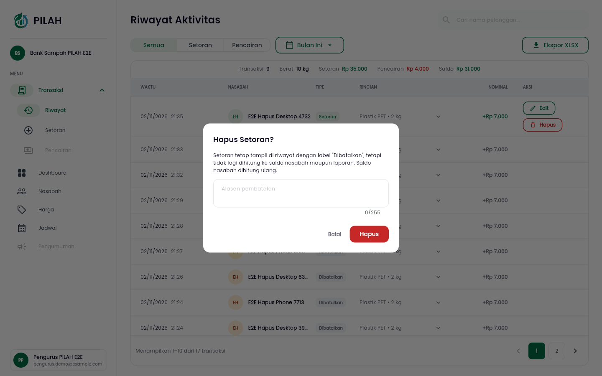
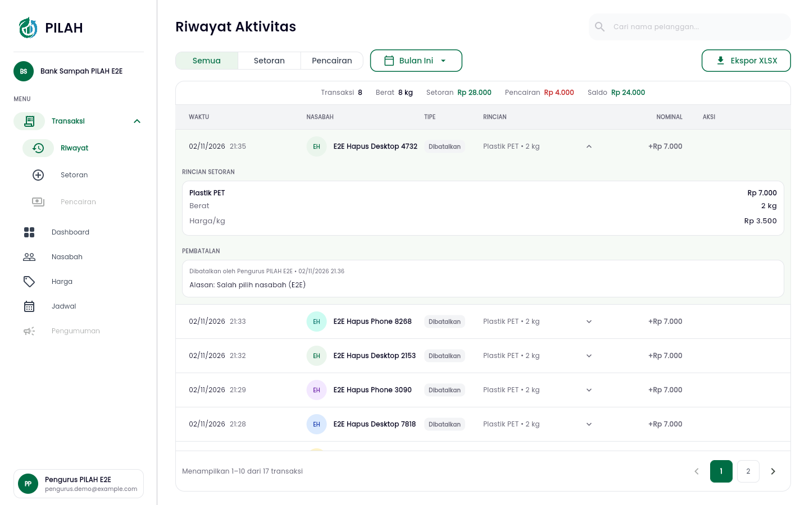
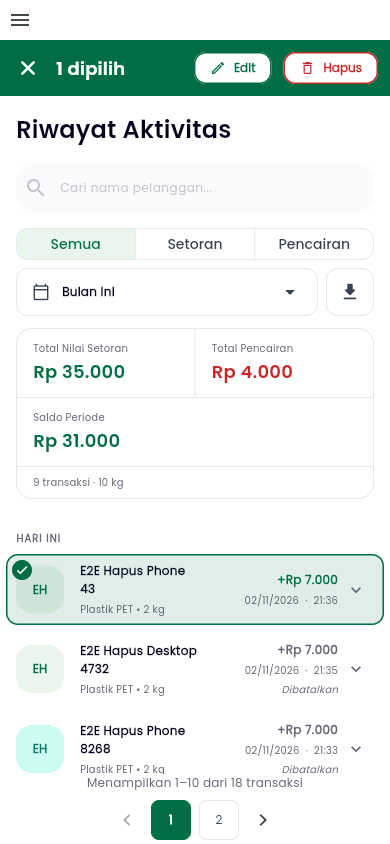

# Test Driven Development

!!! success "Competency level: 4"
    **Level 3 met:** every behaviour this week was built test-first, one behaviour per `[RED]` → `[GREEN]` pair, with the phase in every commit subject and `[REFACTOR]` commits only after green.

    - Every changed line is covered: 100% on SonarCloud for all five MRs touched this week.
    - The tests cover the positive case, each refusal and the corner cases (see [the table](#positive-negative-and-corner-cases)).
    - Tests that pass when written are labelled as coverage tests and committed without a phase tag.

    **Level 4:** advanced testing methods in the commits:

    - **The database as a test oracle:** a check constraint is proven by attempting three half-recorded voids and expecting `IntegrityError` for each.
    - **A real race, made deterministic:** a two-thread `TransactionTestCase` on PostgreSQL pauses a Google login right before it saves a membership, and runs a role change in between.
    - **Mocks, stubs and fakes for isolation:**
        - mobile notifiers run on mocktail mocks of their use cases;
        - page tests run on a `StubApi` that answers per route;
        - the role page uses a fake notifier that records its calls.
    - **E2E with database assertions:** Playwright drives the web build through Flutter's semantics tree at desktop and phone sizes, then reads the void's status, alasan, author and saldo from the backend database.

## Coverage proof at a glance

| MR | Work | SonarCloud new-code coverage | Local diff coverage |
|---|---|---|---|
| pilah-be [#145](https://github.com/bank-sampah-PILAH/pilah-be/pull/145) | PIL-428: void a setoran | [100% of 87 lines](https://sonarcloud.io/component_measures?id=bank-sampah-PILAH_pilah-be&pullRequest=145&metric=new_coverage&view=list) | 100% of 348 changed lines (tests included), Postgres 16, after the 2 Nov refactor |
| pilah-mobile [#193](https://github.com/bank-sampah-PILAH/pilah-mobile/pull/193) | PIL-428: Hapus on phone and web | [100% of 140 lines](https://sonarcloud.io/component_measures?id=bank-sampah-PILAH_pilah-mobile&pullRequest=193&metric=new_coverage&view=list) | 100% of 152 changed `lib/` lines, after the staging merge |
| pilah-mobile [#196](https://github.com/bank-sampah-PILAH/pilah-mobile/pull/196) | PIL-435: Riwayat setoran only | [100% of 23 lines](https://sonarcloud.io/component_measures?id=bank-sampah-PILAH_pilah-mobile&pullRequest=196&metric=new_coverage&view=list) | 100% of 34 changed lines |
| pilah-be [#137](https://github.com/bank-sampah-PILAH/pilah-be/pull/137) | PIL-451, second review round | [100% of 51 lines](https://sonarcloud.io/component_measures?id=bank-sampah-PILAH_pilah-be&pullRequest=137&metric=new_coverage&view=list) | 100%, after a refactor removed a branch no test could reach |
| pilah-mobile [#174](https://github.com/bank-sampah-PILAH/pilah-mobile/pull/174) | PIL-451, second review round | [100% of 91 lines](https://sonarcloud.io/component_measures?id=bank-sampah-PILAH_pilah-mobile&pullRequest=174&metric=new_coverage&view=list) | 100%, after a coverage test for the account-mode Keluar |

The local figures come from `diff-cover` against `origin/staging`, after `coverage run manage.py test` (backend) and `flutter test --coverage` (mobile). Windows writes LCOV paths with backslashes, so they are normalised first.

## Backend: [pilah-be #145](https://github.com/bank-sampah-PILAH/pilah-be/pull/145)

| Behaviour | Red | Green | What the red asserts |
|---|---|---|---|
| A void keeps the row, takes its total out of the saldo, and records who, when and why | [`f3c3db7`](https://github.com/bank-sampah-PILAH/pilah-be/commit/f3c3db7) | [`638cb3f`](https://github.com/bank-sampah-PILAH/pilah-be/commit/638cb3f) | `POST /transaksi/{id}/batalkan` answers 200; the row is `dibatalkan` with `dibatalkan_oleh`, `dibatalkan_pada` and the alasan; the saldo drops by the total |
| A voided setoran is final: voiding again, editing it or resending its WhatsApp receipt gets 409 | [`997c5d0`](https://github.com/bank-sampah-PILAH/pilah-be/commit/997c5d0) | [`b08e3eb`](https://github.com/bank-sampah-PILAH/pilah-be/commit/b08e3eb) | Three 409s, and the row unchanged |
| Money already paid out can't be voided: refused when the saldo, or any later pencairan, would go negative; otherwise later pencairan snapshots shift | [`99de195`](https://github.com/bank-sampah-PILAH/pilah-be/commit/99de195) | [`966c7ba`](https://github.com/bank-sampah-PILAH/pilah-be/commit/966c7ba) | 409 with the saldo and status unchanged; the later pencairan's `saldo_sebelum` moves by the total |
| A voided setoran leaves the saldo history: snapshots, the riwayat summary, the pencairan edit replay | [`516cc0f`](https://github.com/bank-sampah-PILAH/pilah-be/commit/516cc0f) | [`cb0e666`](https://github.com/bank-sampah-PILAH/pilah-be/commit/cb0e666) | The riwayat still lists it with its status, but no total counts it |
| Laporan leave it out: Excel export, dashboard stats, trends, categories, the nasabah statement | [`1aa13a0`](https://github.com/bank-sampah-PILAH/pilah-be/commit/1aa13a0) | [`05b3bf1`](https://github.com/bank-sampah-PILAH/pilah-be/commit/05b3bf1) | Each total equals the one without the voided setoran; an export of only voided rows has no data |
| Nasabah views show it as dibatalkan, and the pengurus ringkasan stops counting it | [`93fd052`](https://github.com/bank-sampah-PILAH/pilah-be/commit/93fd052) | [`773d667`](https://github.com/bank-sampah-PILAH/pilah-be/commit/773d667) | `status: "dibatalkan"` in me/riwayat, beranda and detail; who and why stay pengurus-only |
| The database refuses a half-recorded void | [`31b3ee4`](https://github.com/bank-sampah-PILAH/pilah-be/commit/31b3ee4) | [`2814ae6`](https://github.com/bank-sampah-PILAH/pilah-be/commit/2814ae6) | Three partial updates each raise `IntegrityError` |

**Coverage test:** [`f67aa72`](https://github.com/bank-sampah-PILAH/pilah-be/commit/f67aa72) covers alasan required, other banks' setoran 404, and a nasabah 403. These guards come from the serializer, the bank-scoped queryset and `IsActivePengelola`, so the tests passed on the first run. The commit says so.

**Refactor after green:** [`ae850a0`](https://github.com/bank-sampah-PILAH/pilah-be/commit/ae850a0) routes every counted-setoran query through `Transaksi.objects.tercatat()`. The full suite gives the same result before and after: 898 tests, and only the 5 known Windows deployment-script failures.

The constraint test, which uses the database itself as the oracle:

```python title="apps/ledger/test_setoran_void.py"
def test_database_refuses_a_void_without_who_when_and_why(self) -> None:
    setengah: list[dict[str, Any]] = [
        {"status": Transaksi.Status.DIBATALKAN},
        {"status": Transaksi.Status.DIBATALKAN, "dibatalkan_oleh": self.pengelola},
        {"alasan_batal": "x", "dibatalkan_pada": timezone.now()},
    ]
    for fields in setengah:
        with self.subTest(fields=fields), self.assertRaises(IntegrityError):
            with transaction.atomic():
                Transaksi.objects.filter(pk=self.transaksi.pk).update(**fields)
```

`.update()` skips the service and the serializer, so only the database can refuse these.

## Mobile: [pilah-mobile #193](https://github.com/bank-sampah-PILAH/pilah-mobile/pull/193)

| Behaviour | Red | Green |
|---|---|---|
| A voided setoran is marked in the riwayat feed (grey amount, "Dibatalkan") | [`fe6cb9f`](https://github.com/bank-sampah-PILAH/pilah-mobile/commit/fe6cb9f) | [`ca482d2`](https://github.com/bank-sampah-PILAH/pilah-mobile/commit/ca482d2) |
| The notifier voids through `BatalkanTransaksiUseCase` and returns the detail or the server's reason | [`d511208`](https://github.com/bank-sampah-PILAH/pilah-mobile/commit/d511208) | [`5b76c4f`](https://github.com/bank-sampah-PILAH/pilah-mobile/commit/5b76c4f) |
| Hapus from the phone's selection header, with a required alasan | [`0e102d4`](https://github.com/bank-sampah-PILAH/pilah-mobile/commit/0e102d4) | [`cd2cad4`](https://github.com/bank-sampah-PILAH/pilah-mobile/commit/cd2cad4) |
| Hapus in the web Aksi column; none on a voided row | [`65ed307`](https://github.com/bank-sampah-PILAH/pilah-mobile/commit/65ed307) | [`3db0fa9`](https://github.com/bank-sampah-PILAH/pilah-mobile/commit/3db0fa9) |
| The detail sheet shows who voided it, when and why | [`0ffc9d3`](https://github.com/bank-sampah-PILAH/pilah-mobile/commit/0ffc9d3) | [`24be713`](https://github.com/bank-sampah-PILAH/pilah-mobile/commit/24be713) |
| **Found by E2E:** the dialog stays narrow on desktop, and a voided detail shows no saldo | [`df1fc4c`](https://github.com/bank-sampah-PILAH/pilah-mobile/commit/df1fc4c) | [`4d16698`](https://github.com/bank-sampah-PILAH/pilah-mobile/commit/4d16698) |
| **After the staging merge:** the new inline detail (PIL-453) shows the pembatalan and no saldo | [`5af4e5d`](https://github.com/bank-sampah-PILAH/pilah-mobile/commit/5af4e5da) | [`ef7a0b9`](https://github.com/bank-sampah-PILAH/pilah-mobile/commit/ef7a0b96) |

**Refactor after green:** [`ca2ec7a`](https://github.com/bank-sampah-PILAH/pilah-mobile/commit/ca2ec7a2) replaces three nested ternaries with a guard clause, after SonarCloud's S3358. The 321 transaksi tests passed before and after.

**A merge is not a free pass on TDD.** Staging's PIL-453 replaced the detail sheet in Riwayat with an inline expansion. My merge commit carried over only what already had tests: the Hapus button, the badge and the selection rule. The Pembatalan section the inline detail was missing came as its own red/green pair. The red failed with `Found 0 widgets with text "PEMBATALAN"`, and with the saldo row still present.

## Mobile: [pilah-mobile #196](https://github.com/bank-sampah-PILAH/pilah-mobile/pull/196)

| Step | Commit | Result |
|---|---|---|
| Refactor first, so the change is one edit: name the offered and default types | [`b577c7c`](https://github.com/bank-sampah-PILAH/pilah-mobile/commit/b577c7c) | 289 transaksi tests pass before and after |
| Red: Riwayat opens on setoran, asks for `tipe=setoran`, resets to it, shows no type selector, and drops pencairan and saldo from the summary | [`9606e96`](https://github.com/bank-sampah-PILAH/pilah-mobile/commit/9606e96) | 9 intended failures. A tenth, a large-text layout test, was traced to my own new test row pushing Budi off screen, and fixed in the test data, not the app |
| Green | [`1b52638`](https://github.com/bank-sampah-PILAH/pilah-mobile/commit/1b52638) | 295 pass |
| Coverage: the phone selector for when Pencairan reopens | [`48f138b`](https://github.com/bank-sampah-PILAH/pilah-mobile/commit/48f138b) | Diff coverage 100% |

## Review fixes: [#137](https://github.com/bank-sampah-PILAH/pilah-be/pull/137) and [#174](https://github.com/bank-sampah-PILAH/pilah-mobile/pull/174)

| Finding | Red | Green / refactor | The red failed on |
|---|---|---|---|
| #137: the Google-login membership claim races a role change (Tristan P1, Heraldo) | [`c428c32`](https://github.com/bank-sampah-PILAH/pilah-be/commit/c428c32) | [`d19cb8d`](https://github.com/bank-sampah-PILAH/pilah-be/commit/d19cb8d), then [`7c7c1f3`](https://github.com/bank-sampah-PILAH/pilah-be/commit/7c7c1f3) and [`e077084`](https://github.com/bank-sampah-PILAH/pilah-be/commit/e077084) | `{'changed': True, 'waited_for_registration': False}`, and `401 != 200 : {'error': 'ID Token invalid atau expired'}` |
| #174: a same-role pick drops the draft (Scallss, Heraldo); a real change leaves the old input in the form (Tristan P2) | [`26dce38`](https://github.com/bank-sampah-PILAH/pilah-mobile/commit/26dce385) | [`3d0a81b`](https://github.com/bank-sampah-PILAH/pilah-mobile/commit/3d0a81b3) | `hasProfileDraft` false; "Diketik Untuk Pengurus" still in the name field |

The race test reuses last week's harness. The registration thread here is a Google login, paused inside `Nasabah.save`:

```python title="tests/regression/identity/test_role_change_race.py"
outcome = self._race(
    user,
    lambda _u: AuthService.login_with_google("t"),
    (Nasabah, "save"),
    User.Role.PENGELOLA,
)

self._assert_role_kept(user, User.Role.NASABAH, outcome)
self.assertTrue(Nasabah.objects.filter(user=user, bank_sampah=bank).exists())
```

**A guard test that passed on purpose.** "A new session for the same role keeps what was typed" passed in the red commit. It's there so the fix can't overreach by clearing the form on every new session, and the commit says so.

**A query count, checked rather than assumed.** For Heraldo's nit, `lock_account` should lock and reload in one query. `CaptureQueriesContext` showed exactly one query, ending `FOR UPDATE`. The race tests then confirmed the lock still serializes all four writers.

## Positive, negative and corner cases

| Behaviour | Positive | Negative | Corner |
|---|---|---|---|
| Void, backend (#145) | 200; status, who, when and why stored; saldo reduced; later pencairan shifted | No alasan: 422. Another bank's setoran: 404. A nasabah: 403. Already voided, editing or resending WA: 409. Money paid out: 409 with nothing changed | A later pencairan that would become unfunded even though the final saldo stays positive: 409. Only voided rows in an export period: no data. A partial update straight to the database: `IntegrityError` |
| Void, mobile (#193) | Hold a row, then Hapus with an alasan: the row is "Dibatalkan" and the saldo is unchanged in the database | Empty alasan: "Alasan pembatalan wajib diisi", nothing sent. A 409 refusal stays in the dialog | A voided row can't be selected again; holding it expands its detail. On desktop the dialog stays 420 px wide |
| Riwayat setoran only (#196) | Opens on setoran; every request has `tipe=setoran` | No Semua/Pencairan control on either layout; the summary has no pencairan or saldo | Reset returns to setoran, not Semua. With every type offered (the reopen path), the selector still works |
| Role change, second round (#137, #174) | A real role change resets the form to the account's saved profile | A role change during a Google-login claim waits, then gets 409 | A login loaded before a role change signs in as the new role and links nothing. A same-role pick keeps the draft |

## E2E (Playwright)

Run against `flutter build web --profile` and a local backend, at 1440×900 and 390×844. Each run creates fresh data through the Django shell and reads the result back from the database.

- **PIL-428, 21/21 checks**, re-run on 2 Nov after the staging merge:
    - Hapus without an alasan is refused, and nothing is voided yet;
    - with an alasan, the database holds `dibatalkan`, the alasan, the pengurus's email and a saldo of 0;
    - the inline detail shows PEMBATALAN and no saldo;
    - on a phone, a voided row can't be selected.
- **PIL-435, 18/18 checks:** no Semua or Pencairan type, no pencairan or saldo total, and every `/aktivitas` request asks for `tipe=setoran`, including after Reset. A nasabah with one setoran and one pencairan shows "1 transaksi".

{ width="620" }

{ width="620" }

{ width="220" }
